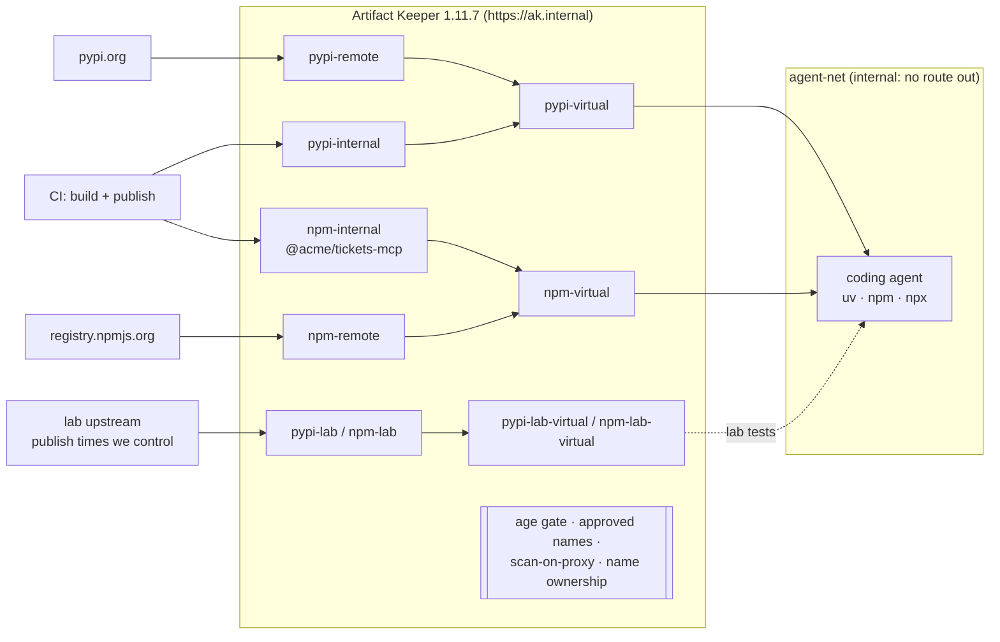

---
tags:
  - AI agents
  - MCP
  - PyPI
  - npm
  - uv
  - supply chain
  - curation
  - cooldown
  - dependency confusion
  - vulnerability scanning
description: >-
  An AI coding agent that can only install what the registry allows: a sandbox that can only
  reach Artifact Keeper, approved package names, a release cooldown, internal names nobody can
  shadow, and known-vulnerable versions refused.
---

# An AI coding agent that can only install what the registry allows

!!! warning "An example, not a complete defense"
    This walkthrough shows one way to put Artifact Keeper in the path between an AI coding agent
    and public package indexes. The configuration is an example, built and tested in a lab. It
    does not cover every edge case or attack, and it is not a hardened production setup. Some
    gaps we found are listed in [Findings](findings.md). Review and adapt it for your own
    environment, and use it alongside your other controls (code review, sandboxing, secrets
    handling, monitoring), not instead of them.

!!! info "What this covers, and what it does not"
    **Covers:** which third-party package files `uv`, `pip`, `npm` and `npx` can fetch, and from
    where. The registry decides which names, which versions and which upstreams are allowed.

    **Does not cover:** code the agent writes itself; data sent out over the model API; secrets
    inside the sandbox; what an MCP server does once it runs; code that an approved package runs
    when it is installed or imported; a malicious release of an approved package that nobody
    detects within the seven-day cooldown; internal packages that CI publishes.

Coding agents (Claude Code, Codex, Cursor, Copilot agent mode, Gemini CLI) run `uv add`,
`pip install`, `npm install` and `npx` on their own, and MCP servers arrive as packages too. This
walkthrough keeps the agent's autonomy and moves the decision about which packages reach disk to
the registry. The agent runs in a sandbox that can only reach
[Artifact Keeper](https://github.com/artifact-keeper/artifact-keeper), at `ak.internal`, with a
token that can only read the virtual repositories. Changing a client setting does not get around
it, because the sandbox cannot reach any other host.

Everything runs in containers on one host. The code is in
[`ai-agent-dependency-guardrails/`](https://github.com/artifact-keeper/walkthroughs/tree/main/ai-agent-dependency-guardrails)
and `make all` reproduces it from an empty registry in about five minutes (plus the first image pulls).

!!! note "Registry version"
    The walkthrough targets the **Artifact Keeper 1.11.7** release (web UI 1.11.1), unmodified.
    Where 1.11.7 falls short, the page says so and the gap is listed in the
    [findings](findings.md) with a proposed fix.

## Who this is for

Platform and security teams rolling out coding agents and MCP servers to their developers. The
question is not "can we stop the agent?" but "can we make sure that whatever the agent decides,
the only third-party packages that reach disk are names a person reviewed, at versions old enough
and without a known advisory?"

## Why now

- Language models suggest packages that do not exist: on average at least 5.2 % of the packages
  suggested by commercial models and 21.7 % of those from open models were hallucinated, across
  576,000 generated code samples from 16 models
  ([Spracklen et al., USENIX Security 2025](https://arxiv.org/abs/2406.10279)). Attackers
  register those names; the practice has a name, slopsquatting. An empty package Lasso Security
  published under one such name, `huggingface-cli`, got more than 30,000 downloads in three months
  ([Lasso Security](https://www.lasso.security/blog/ai-package-hallucinations)).
- Popular packages get compromised, and the bad release is usually caught within hours or
  days. On 2026-03-24 two malicious LiteLLM releases, published with stolen PyPI credentials,
  were live for a few hours (roughly five, by the CSA's timeline) and one of them, 1.82.8, ran its
  payload on every Python start
  ([CSA research note](https://labs.cloudsecurityalliance.org/research/csa-research-note-litellm-pypi-backdoor-ai-toolchain-supply/)).
  The 2025 npm compromises (chalk and debug in September, the Shai-Hulud worms in September and
  November) followed the same pattern. A cooldown keeps young releases out meanwhile.
- MCP servers are distributed as npm and PyPI packages and started with `npx -y` or `uvx`,
  which fetch whatever is newest on every run.
- Malware has already driven a developer's own coding agent, with its safety checks turned off,
  to search for secrets: the malicious Nx releases of 2025-08-26 ran Claude Code with
  `--dangerously-skip-permissions`, Gemini CLI with `--yolo` and Amazon Q with
  `--trust-all-tools` ([Snyk](https://snyk.io/blog/weaponizing-ai-coding-agents-for-malware-in-the-nx-malicious-package/)).
  A cooldown would have held those releases; nothing in this walkthrough stops code that is
  already installed from using the agent.

## What you will see

| The agent asks for | The registry answers | Step |
|---|---|---|
| a reviewed package | served | [3](3-publish-and-lock.md) |
| a name nobody reviewed: invented, a look-alike, an MCP server via `npx -y` | `403 curation_blocked`, before any package file is downloaded (npm still fetches the package's metadata) | [4](4-approve-names.md) |
| a release published 10 minutes ago | left out of the index; pinned, `451 age_gate_blocked` with a review id | [5](5-hold-fresh-releases.md) |
| a public package reusing an internal name at version 99 | never offered; the internal 1.0.0 resolves | [6](6-own-your-names.md) |
| a version with a high or critical advisory | `403 scan_blocked` (refused, not served, if the scan cannot finish) | [7](7-refuse-known-vulnerable.md) |
| `--default-index https://pypi.org/simple/` | blocked: DNS does not resolve | [2](2-sandbox-the-agent.md) |

## The shape of it



The demo application, `acme-agent`, is a small Python service that uses the `anthropic` and `mcp`
SDKs and an internal library, `acme-agent-tools`, and starts an internal MCP server,
`@acme/tickets-mcp`. Nothing calls a model; the application only has to install and start. The
"coding agent" is a scripted session of twelve actions an agent might take
([Step 8](8-replay-an-agent-session.md)), with no model in the loop, so every run is the same. The
sandbox works the same way with a real agent CLI inside it.

## Before you start

- A Linux host with rootless podman 5.x and `podman compose` backed by docker-compose 2.24 or
  newer, with the user podman socket on (`systemctl --user enable --now podman.socket`).
- bash 4+, curl, jq, openssl, GNU make, `column` and Python 3.11 or newer. No sudo, no GPU, no
  model API key.
- About 8 GB of free RAM and 10 GB of disk.

!!! tip "Run it yourself"
    ```bash
    git clone https://github.com/artifact-keeper/walkthroughs
    cd walkthroughs/ai-agent-dependency-guardrails
    make all          # registry, policies, sandbox, internal packages, approved list,
                      #   install and run the app, replay the agent session
    make gates        # G1-G11 with evidence in out/gates/
    make reproduce    # three runs: from empty, again without cleaning, from empty
    ```

    `make clean` and `make reproduce` delete the stack, its volumes, the tokens and the images
    it pulled. `make all` alone re-runs on a running stack.

## Steps

1. [Stand up the registry](1-stand-up-the-registry.md): Artifact Keeper behind `https://ak.internal`, the repositories, the tokens.
2. [Put the agent in a sandbox](2-sandbox-the-agent.md): the only host it can reach is `ak.internal`, and every client points there.
3. [Publish internal packages and lock the app](3-publish-and-lock.md): the reviewed baseline.
4. [Approve names, not just versions](4-approve-names.md): invented and look-alike names refused before any package file is downloaded.
5. [Hold fresh releases](5-hold-fresh-releases.md): a seven-day cooldown at the registry, and how to approve a security fix early.
6. [Own your internal names](6-own-your-names.md): dependency confusion and squatted MCP servers.
7. [Refuse known-vulnerable versions](7-refuse-known-vulnerable.md): every proxied file is scanned before it is served.
8. [Replay an agent session](8-replay-an-agent-session.md): twelve scripted actions, what the registry said, and what you can audit.

Then [Results](results.md), [Findings](findings.md) and [Next steps](next-steps.md). The
[plan](plan.md) is the design we started with, and its last section is the fix plan from the
reviews of the first version.

## Terms used here

- **Hosted repository:** holds packages you publish (`pypi-internal`, `npm-internal`).
- **Remote repository:** a caching proxy for a public index (`pypi-remote` for pypi.org).
- **Virtual repository:** one URL in front of several hosted and remote repositories, searched in
  priority order. Clients only ever see the virtuals.
- **Packument:** npm's metadata document for a package: every version and its tarball URL.
- **Cooldown (age gate):** the registry holds versions younger than seven days.
- **451:** the HTTP status the registry uses for "held by the cooldown, pending review".
