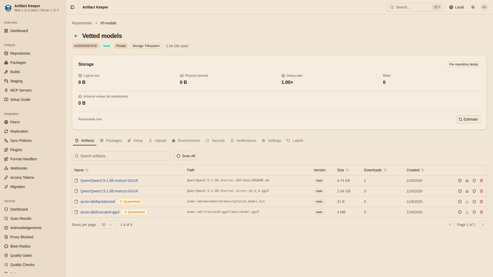
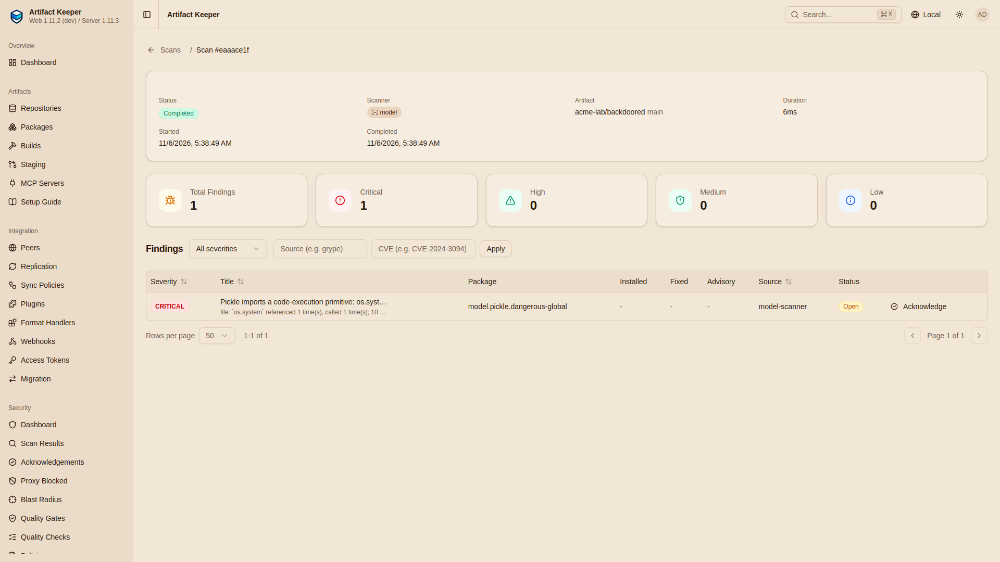

# Step 3: Vet what you seeded

--8<-- "includes/preview-offgrid.md"

Still connected, the seeded content is checked before the site relies on it: the model goes
through a door that scans it, the vulnerability scanner gets a database it can use offline, and
the configuration and the inventory are written down as the records the site is compared
against later.

```bash
make vet    # flows/vet.sh
```

## The model, through the model-file scanner

[`flows/vet.sh`](https://github.com/artifact-keeper/walkthroughs/blob/main/off-grid-ai-stack/flows/vet.sh)
downloads the model's files from `hf-hub`'s cache at the seeded commit, and publishes them to
`hf-models`, the vetted Local. There every upload is scanned, including by the model-file
scanner ([#5337](https://github.com/artifact-keeper/artifact-keeper/pull/5337)), and the policy
`hf-models-vetted` ([Step 1](1-stand-up-the-registry.md#the-vetting-policy)) serves a file only
once a scan has completed with nothing at or above medium:

```bash
POST /huggingface/hf-models/api/models/<repo_id>/upload/main     X-Filename: <file>   (publisher)
GET  /api/v1/security/artifacts/<id>/scans
```

```console
$ make vet
flows/vet.sh

== 1a. the model from hf-hub's cache, at the seeded commit
  qwen2.5-1.5b-instruct-q4_k_m.gguf: 1117320736 bytes, sha256 6a1a2eb6d15622bf
  README.md: 4856 bytes, sha256 57c72d4010fb11a9

== 1b. publish it to hf-models (scan on upload, policy hf-models-vetted)
  upload Qwen/Qwen2.5-1.5B-Instruct-GGUF/qwen2.5-1.5b-instruct-q4_k_m.gguf: HTTP 200 {"path":"Qwen/Qwen2.5-1.5B-Instruct-GGUF/main/qwen2.5-1.5b-instruct-q4_k_m.gguf","size":1117320736}
  upload Qwen/Qwen2.5-1.5B-Instruct-GGUF/README.md: HTTP 200 {"path":"Qwen/Qwen2.5-1.5B-Instruct-GGUF/main/README.md","size":4856}
  qwen2.5-1.5b-instruct-q4_k_m.gguf scans: [{"scan_type":"grype","status":"running","findings_count":0},{"scan_type":"not_applicable","status":"not_applicable","findings_count":0},{"scan_type":"model","status":"completed","findings_count":0},{"scan_type":"dependency","status":"completed","findings_count":0}]
  findings: []
  HEAD hf-models .../resolve/main/qwen2.5-1.5b-instruct-q4_k_m.gguf: HTTP 200, X-Repo-Commit a71c397e3525cbdb7147522bdd3561b918479c21
```

The `model` scan completed with no finding, and `hf-models` serves the file. Its commit in
`hf-models` (`a71c397e...`) is the Local repository's own, not the upstream one: the file is the
same (gate G1 compares the SHA-256 with the one the seed job recorded), its history is not.

### Two files that must not get through

Two counter-examples go through the same door, written by the script and never run:

- `acme-lab/truncated-gguf/model.gguf`: the first 4 MiB of the real GGUF. The header still
  claims every tensor; their data is gone.
- `acme-lab/backdoored/pytorch_model.bin`: a 31-byte protocol-2 pickle that imports
  `os.system` and calls it with `id`.

```console
== 1c. two files that must not get through
  upload acme-lab/truncated-gguf/model.gguf: HTTP 200 {"path":"acme-lab/truncated-gguf/main/model.gguf","size":4194304}
  acme-lab/truncated-gguf/model.gguf scans: [{"scan_type":"grype","status":"running","findings_count":0},{"scan_type":"not_applicable","status":"not_applicable","findings_count":0},{"scan_type":"model","status":"completed","findings_count":1},{"scan_type":"dependency","status":"completed","findings_count":0}]
    findings: [{"severity":"medium","rule":"model.gguf.malformed","title":"GGUF header is malformed: file"}]
    GET .../resolve/main/model.gguf: HTTP 403
  upload acme-lab/backdoored/pytorch_model.bin: HTTP 200 {"path":"acme-lab/backdoored/main/pytorch_model.bin","size":31}
  acme-lab/backdoored/pytorch_model.bin scans: [{"scan_type":"grype","status":"running","findings_count":0},{"scan_type":"not_applicable","status":"not_applicable","findings_count":0},{"scan_type":"model","status":"completed","findings_count":1},{"scan_type":"dependency","status":"completed","findings_count":0}]
    findings: [{"severity":"critical","rule":"model.pickle.dangerous-global","title":"Pickle imports a code-execution primitive: os.system"}]
    GET .../resolve/main/pytorch_model.bin: HTTP 403
```

In the web UI (from a run of the same clone), the two files are badged "Quarantined" in
`hf-models`, and the pickle's finding reads as the scanner reports it:





grype and the dependency scanner find nothing in either file: they look for packages, and a
model file has none. The model-file scanner flags both, and the policy refuses both with `403`.

!!! warning "What the model-file scanner does not do"
    It reads structure: GGUF and safetensors headers, and the opcodes of a pickle, looking for
    imports of code-execution primitives. It caught a GGUF that does not hold together
    (`model.gguf.malformed`, medium) and a pickle that imports `os.system`
    (`model.pickle.dangerous-global`, critical). It does not judge what a model does: a
    well-formed GGUF with poisoned weights, a backdoor trigger or a bad chat template scans
    clean. A clean scan means "nothing known-bad in the file's structure", not "safe".

## The scanner adapter, offline

The scanner adapter runs Trivy for image scans. With `SCANNER_OFFLINE=true`
([#5314](https://github.com/artifact-keeper/artifact-keeper/pull/5314)) it never downloads a
database; it is not ready until one is imported. The trivy database was seeded through
`oci-ghcr` as an OCI artifact ([Step 2](2-seed-the-stack.md#1-images)); the script fetches its
layer through the registry and imports it with `PUT /api/v1/vulndb` on the adapter (from a
container on the stack's network, with the adapter's shared token):

```console
== 2. the scanner adapter, offline: import the trivy database through oci-ghcr
  oci-ghcr/aquasecurity/trivy-db:2: manifest HTTP 200, layer sha256:c367ecccf6a0367b915ef00b90c43e5958f9ecd9ee6118d2876af6deeca8523c (application/vnd.aquasec.trivy.db.layer.v1.tar+gzip)
  blob: HTTP 200, 138781380 bytes
  ready before the import: HTTP 503
  GET /api/v1/vulndb before: HTTP 404
{"imported":{"version":2,"updated_at":"2026-11-06T01:07:43.832840315Z","next_update":"2026-11-07T01:07:43.832839854Z","downloaded_at":"2026-11-06T05:11:00.592006371Z","age_seconds":14596,"stale":false,"offline":true},"sha256":"c367ecccf6a0367b915ef00b90c43e5958f9ecd9ee6118d2876af6deeca8523c","forced
{"version":2,"updated_at":"2026-11-06T01:07:43.832840315Z","next_update":"2026-11-07T01:07:43.832839854Z","downloaded_at":"2026-11-06T05:11:00.592006371Z","age_seconds":14604,"stale":false,"offline":true}

  ready after the import: HTTP 200
```

`age_seconds` counts from the database's own `updated_at` (here 01:07 UTC, imported at 05:11),
and it keeps growing on the site. That is the number to watch: an offline scanner is only as
current as the last database carried in ([Next steps](next-steps.md#before-production)).

Then the adapter scans the llama.cpp image from the registry, the linux/amd64 manifest of the
seeded index digest, reading it from the backend with the developer's token. No network beyond
the stack is involved:

```console
== 2b. the adapter scans the llama.cpp image from the registry (no network involved)
{"id":"01c283821a2419fcbe2c63b95c2502b4"}

  report: HTTP 200, {"scanner":{"name":"Trivy","version":"0.76.0"},"vulnerabilities":689}
```

The image has 689 known vulnerabilities (the report starts with one in `apt`); listing them is
the point. The site decides what to do with them; this step shows that it can know, offline.

## The configuration of record

The whole configuration is exported as one document
([#5335](https://github.com/artifact-keeper/artifact-keeper/pull/5335)) to
`out/config/seed.json`, and planned against this same instance, which must change nothing:

```console
== 3. the configuration of record: export, then plan it against this instance
  GET /api/v1/admin/config/export: HTTP 200, 13 repositories
{"key":"hf-hub","repo_type":"remote","format":"huggingface","cache_ttl_seconds":315360000,"egress":"explicit"}
{"key":"hf-models","repo_type":"local","format":"huggingface","cache_ttl_seconds":null,"egress":null}
{"key":"mcp-all","repo_type":"virtual","format":"mcp","cache_ttl_seconds":null,"egress":null}
{"key":"mcp-internal","repo_type":"local","format":"mcp","cache_ttl_seconds":null,"egress":null}
{"key":"mcp-official","repo_type":"remote","format":"mcp","cache_ttl_seconds":315360000,"egress":"explicit"}
{"key":"npm-remote","repo_type":"remote","format":"npm","cache_ttl_seconds":315360000,"egress":"explicit"}
{"key":"oci-dockerhub","repo_type":"remote","format":"docker","cache_ttl_seconds":315360000,"egress":"explicit"}
{"key":"oci-ghcr","repo_type":"remote","format":"docker","cache_ttl_seconds":315360000,"egress":"explicit"}
{"key":"plugins","repo_type":"remote","format":"agentplugins","cache_ttl_seconds":315360000,"egress":"explicit"}
{"key":"plugins-central","repo_type":"local","format":"agentplugins","cache_ttl_seconds":null,"egress":null}
{"key":"pypi","repo_type":"virtual","format":"pypi","cache_ttl_seconds":null,"egress":null}
{"key":"pypi-local","repo_type":"local","format":"pypi","cache_ttl_seconds":null,"egress":null}
{"key":"pypi-remote","repo_type":"remote","format":"pypi","cache_ttl_seconds":315360000,"egress":"explicit"}
  plan: HTTP 200 {"create":0,"update":[],"unchanged":13,"missing_secrets":[],"errors":[],"applicable":true}
```

The `plugins` Remote's upstream token is not in the document: it is exported as
`{"secret_ref": "upstream_auth/plugins"}`, to be supplied when the document is applied
elsewhere. This document is what a second instance would be built from
([Next steps](next-steps.md#two-instances-the-low-side-and-the-high-side)). It also carries each
Remote's upstream mode; [Step 4](4-disconnect.md#3-the-export-with-the-offline-posture) exports
it again once every Remote is cache-only.

## The inventory of record

Last, [`seed/inventory.sh seed`](https://github.com/artifact-keeper/walkthroughs/blob/main/off-grid-ai-stack/seed/inventory.sh)
fetches every manifest item as the developer, the way a client gets it, and writes its SHA-256
to `out/inventory/seed.tsv`. The Python rows come from `pip download --require-hashes --no-deps`
of the lock in a fresh container, so they are the exact wheels a clean install gets. The columns
are on [Seed manifest and inventory](reference/seed-manifest.md#the-inventory).

```console
== 4. the inventory of record: every manifest item as the registry serves it now
inventory: 85 items in out/inventory/seed.tsv
  image   4
  mcp     2
  model   4
  npm     2
  plugin  1
  python  72
```

An excerpt (the 72 Python rows left out):

```text
image   oci-dockerhub/library/node:22-bookworm-slim@sha256:5ec23b7c622b00547753bc6ffd78085dd868a68aeb41c8e0a1418f033e13d96d 5ec23b7c622b0054...  5218        oci-dockerhub HTTP 200
image   oci-dockerhub/library/python:3.12-slim-trixie@sha256:b18b261e1b4974b4f321451ad5251ded85abb22c2b8b262da527dda1d031ab30 b18b261e1b4974b4...  10373       oci-dockerhub HTTP 200
image   oci-ghcr/aquasecurity/trivy-db:2                                                 fb417a88061be7d8...  616         oci-ghcr HTTP 200
image   oci-ghcr/ggml-org/llama.cpp:server-b12124@sha256:c0a11067c72bb1eb330b8bddbf9869274c195e596bf4fae55fd527102e644b85 c0a11067c72bb1eb...  1419        oci-ghcr HTTP 200
mcp     com.acme/inventory@1.0.0                                                         65c3134dc32b8a60...  516         mcp-all HTTP 200
mcp     io.github.daedalus/mcp-sqlite3@0.1.3                                             d8fde7a4cfc3bcb2...  470         mcp-all HTTP 200
model   hf-hub:Qwen/Qwen2.5-1.5B-Instruct-GGUF/qwen2.5-1.5b-instruct-q4_k_m.gguf         6a1a2eb6d15622bf...  1117320736  hf-hub@91cad51170dc HTTP 200
model   hf-hub:Qwen/Qwen2.5-1.5B-Instruct-GGUF/README.md                                 57c72d4010fb11a9...  4856        hf-hub@91cad51170dc HTTP 200
model   hf-models:Qwen/Qwen2.5-1.5B-Instruct-GGUF/qwen2.5-1.5b-instruct-q4_k_m.gguf      6a1a2eb6d15622bf...  1117320736  hf-models@main HTTP 200
model   hf-models:Qwen/Qwen2.5-1.5B-Instruct-GGUF/README.md                              57c72d4010fb11a9...  4856        hf-models@main HTTP 200
npm     @anthropic-ai/claude-code@2.1.318                                                d86c0189406af48b...  29472       npm-remote HTTP 200
npm     @anthropic-ai/claude-code-linux-x64@2.1.318                                      2a4d5e3bd0f5bd29...  157335063   npm-remote HTTP 200
plugin  offgrid-ops@1.0.0                                                                334b543db38221fe...  2502        plugins HTTP 200
```

The model appears twice on purpose: the copy in `hf-hub`'s cache at the upstream commit, and
the vetted copy in `hf-models`, with the same SHA-256.
