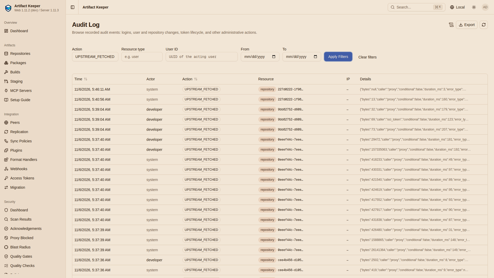

# Step 7: Prove nothing leaves

--8<-- "includes/preview-offgrid.md"

!!! tip "If something goes wrong"
    See [Troubleshooting](reference/troubleshooting.md): every failure we hit while building
    this walkthrough, with its cause and fix.

The claim of this walkthrough is that after the cut nothing leaves, while the site does
everything Steps 5 and 6 and gate G6 do. No single measurement proves that. Gate
[G7](https://github.com/artifact-keeper/walkthroughs/blob/main/off-grid-ai-stack/gates/g07-zero-egress.sh)
makes five independent ones, G7a to G7e, and a control that shows the instruments would have
seen an attempt. This page describes each one so that you can judge it on its own: what it
measures, why a leak would show up in it, and what it does not cover.

```bash
make gates                 # all seven gates; G7 runs last
gates/run-all.sh g07       # G7 alone (after make agent, make claude and gates/run-all.sh g06)
```

G7 runs on the site network and reads the marks `make disconnect` wrote
(`out/disconnect.json`: the time of the cut, the ledger's count, the audit counts).

!!! warning "The scope of the proof"
    "Nothing leaves" is proven for this lab's containers on this lab's network, for the time
    between `make disconnect` and the end of G7. It is not a proof about the host (which has a
    route out and runs podman), about other networks, or about your network. In production the
    isolation is your network design, and these checks are how you test it, not a substitute
    for it.

## G7a: no route out from any container

**What it measures.** For every running `ak-offgrid-*` container (the stack, the ledger,
llama-server), a probe container joins that container's own network namespace
(`podman run --network container:<name>`) and tries TCP connections to `1.1.1.1:443`,
`8.8.8.8:53`, `huggingface.co:443`, `registry-1.docker.io:443` and `pypi.org:443`. Every attempt
must fail, and more than five containers must have been probed.

```console
  ak-offgrid-backend           1.1.1.1 OSError; 8.8.8.8 OSError; huggingface.co gaierror; registry-1.docker.io gaierror; pypi.org gaierror
  ak-offgrid-caddy             1.1.1.1 OSError; 8.8.8.8 OSError; huggingface.co gaierror; registry-1.docker.io gaierror; pypi.org gaierror
  ak-offgrid-db                1.1.1.1 OSError; 8.8.8.8 OSError; huggingface.co gaierror; registry-1.docker.io gaierror; pypi.org gaierror
  ak-offgrid-ledger            1.1.1.1 OSError; 8.8.8.8 OSError; huggingface.co gaierror; registry-1.docker.io gaierror; pypi.org gaierror
  ak-offgrid-llama             1.1.1.1 OSError; 8.8.8.8 OSError; huggingface.co gaierror; registry-1.docker.io gaierror; pypi.org gaierror
  ak-offgrid-opensearch        1.1.1.1 OSError; 8.8.8.8 OSError; huggingface.co gaierror; registry-1.docker.io gaierror; pypi.org gaierror
  ak-offgrid-scanner-adapter   1.1.1.1 OSError; 8.8.8.8 OSError; huggingface.co gaierror; registry-1.docker.io gaierror; pypi.org gaierror
  ak-offgrid-web               1.1.1.1 OSError; 8.8.8.8 OSError; huggingface.co gaierror; registry-1.docker.io gaierror; pypi.org gaierror
PASS              G7a  no route out from any of the 8 running containers (stack, ledger, llama-server)
```

**Why it would catch a leak.** It tests the network itself, not Artifact Keeper's behaviour:
any process in these namespaces, whatever its code path or proxy settings, has the same routes
the probe has. The IP addresses fail with `OSError` (no route: the internal network has no default route); the names
fail with `gaierror`, because the internal network's DNS does not resolve outside names. Gate
G6 runs the same kind of probe in the agent's container.

**What it does not cover.** Containers that are not running at the time (the agent and Claude
Code containers are short-lived; G6 probes one agent container); the host, which has a route
out; ports and protocols other than the ones tried (the probe is TCP to five destinations: a
missing route makes the others fail too, but the probe does not test UDP or ICMP); and any
path that does not need a route, such as a shared volume or the host port, which is inbound
only.

## G7b: the egress ledger gained no connection

**What it measures.** The ledger's `open` lines with a time at or after the cut, twice: all of
them (raw), and those outside the windows of earlier G7 controls (`out/gates/control-windows.tsv`,
compared to the second), which must be none. Both numbers are printed, so a reader can see what
the filter left out.

```console
disconnected at 2026-11-06T05:13:07Z (ledger had 24 lines)
...
control windows of earlier runs: 0
ledger: 24 connections at the disconnect, 24 now; opened since then: 0, of them outside control windows: 0
PASS              G7b  the egress ledger saw no connection opened since the disconnect (outside the control windows)
```

The check fails closed: if the window file cannot be read or the filter fails, the count is
`ERR` and the check fails, instead of passing on an empty result. A first version of this gate
did pass on an empty result: on a first gate run its window list was not valid JSON, the filter
stopped with a `jq` error and counted nothing ([findings B16](findings.md#behaviour-worth-knowing)).

**Why it would catch a leak.** Every Remote's egress proxy is the ledger (G1 checks it), and
cache-only or not, an upstream request from a Remote goes through it. The ledger writes the
`open` line when the request arrives, before it tries to connect, so on the site, where the
connection then fails, the attempt is still written down. The ledger is a separate process in
a separate container: a backend that did not log its own request would still show up here.

**What it does not cover.** Connections that do not use the egress proxy: anything that opens a
socket directly. Those are what G7a rules out at the network level, and G7d's audit rows cover
the backend's own upstream client. The ledger counts connections, not requests, so it would
show that something tried to leave, not how much. A real attempt inside a control window of an
earlier G7 run would be left out of the filtered count, but not of the raw one printed next to
it; the windows are a few seconds each and listed in the file.

## G7c: the cache answered, and no miss went upstream

**What it measures.** Artifact Keeper's Prometheus counter `ak_proxy_cache_lookups_total`, per
Remote and result. The backend was recreated at the cut, so these counters cover the site only.
Three checks: the Remotes the site used (`oci-ghcr`, `oci-dockerhub`, `pypi-remote`,
`npm-remote`, `plugins`) have hits; on every Remote, the misses (`miss` and `miss_*`) are no
more than the `cache_only_miss` count; and `ak_proxy_stale_if_error_responses_total` is 0.

```console
ak_proxy_cache_lookups_total{repository="hf-hub",result="cache_only_miss"} 2
ak_proxy_cache_lookups_total{repository="hf-hub",result="miss"} 2
ak_proxy_cache_lookups_total{repository="npm-remote",result="cache_only_miss"} 1
ak_proxy_cache_lookups_total{repository="npm-remote",result="hit"} 12
ak_proxy_cache_lookups_total{repository="oci-dockerhub",result="hit"} 1
ak_proxy_cache_lookups_total{repository="oci-ghcr",result="cache_only_miss"} 2
ak_proxy_cache_lookups_total{repository="oci-ghcr",result="hit"} 5
ak_proxy_cache_lookups_total{repository="plugins",result="hit"} 10
ak_proxy_cache_lookups_total{repository="pypi-remote",result="cache_only_miss"} 3
ak_proxy_cache_lookups_total{repository="pypi-remote",result="hit"} 142
PASS              G7c  the Remotes the site used answered from the cache (hit > 0: oci-ghcr oci-dockerhub pypi-remote npm-remote plugins)
PASS              G7c  every cache miss on a cache-only Remote ended at the cache-only gate (miss <= cache_only_miss)
PASS              G7c  nothing was served stale (ak_proxy_stale_if_error_responses_total is 0)
```

**Why it would catch a leak.** A cache-only miss is counted twice: as a cache lookup `miss`,
then as `cache_only_miss` at the gate where a cache-only Remote stops instead of going
upstream. A miss that is not matched by a `cache_only_miss` is one that went on toward the
upstream. A stale response would mean an entry expired and an upstream revalidation was tried
and failed. The hits show that the work was really served from the cache, not that the site
did nothing.

**What it does not cover.** It is the backend's own account of itself, in process memory.
Hosted and virtual repositories (`hf-models`, `pypi-local`, `mcp-all`) never go upstream and are
not counted. The counter does not say which client asked. Read it with G7b and G7d, which do
not depend on these counters.

## G7d: no upstream audit row since the cut

**What it measures.** The audit log's `UPSTREAM_FETCHED` and `MCP_MIRROR_SYNCED` rows since the
cut, raw and outside the control windows. There must be none outside the windows. Like G7b, it
fails closed if the rows or the windows cannot be read.

```console
UPSTREAM_FETCHED since 2026-11-06T05:13:07Z: 0 rows, 0 outside the control windows
MCP_MIRROR_SYNCED since 2026-11-06T05:13:07Z: 0 rows, 0 outside the control windows
PASS              G7d  no UPSTREAM_FETCHED audit row since the disconnect
PASS              G7d  no scheduled MCP sync since the disconnect: no MCP_MIRROR_SYNCED row outside the recorded windows
```

The same check in the web UI, on the stack the screenshots come from (disconnected at
05:41:03 UTC): the audit log filtered to `UPSTREAM_FETCHED`. The page filters by day only, so
the rows from before the cut are listed too; the one row after it, 5:46:11, is that stack's G7
control trying pypi.org.



**Why it would catch a leak.** With `AUDIT_UPSTREAM_FETCHES=all`, every request the backend's
upstream client sends is a row, whether it succeeds or fails, with the repository, host, path
and the user it was for. The control below shows a failed attempt on the site becoming a row
(`"result": "error", "error_type": "connect"`). The ledger counts connections; this counts
requests. An MCP sync that ran would write `MCP_MIRROR_SYNCED`, success or not.

**What it does not cover.** Upstream calls that do not go through the audited client. The one
known gap, the cold-HEAD probe (a `HEAD` for something the cache does not hold), is audited
since [#5414](https://github.com/artifact-keeper/artifact-keeper/pull/5414) (`main` at
`a2f53502`, [#5347](https://github.com/artifact-keeper/artifact-keeper/issues/5347)); on a
cache-only Remote it must not run at all, and gate G6 checks that three cold `HEAD`s open no
ledger connection and write no row ([Step 8](8-prove-it-fails-safely.md)). The audit log is written by the
process it audits: a backend that was itself compromised could leave rows out. G7a and G7b do
not depend on it.

## G7e: the site serves the seeded inventory

**What it measures.** `seed/inventory.sh site` fetches every manifest item on the site, as a
client would, into `out/inventory/site.tsv`. Its first three columns (kind, name, SHA-256) must
be identical to `seed.tsv` from [Step 3](3-vet-what-you-seeded.md#the-inventory-of-record), and
no item may be missing (`-`).

```console
inventory: 85 items in out/inventory/site.tsv
  image   4
  mcp     2
  model   4
  npm     2
  plugin  1
  python  72
inventory diff (kind, name, sha256): 0 lines
PASS              G7e  the site serves exactly the seeded inventory (85 items, same SHA-256 each)
```

**Why it matters.** It is a completeness check, not an egress check: the site holds, byte for
byte, everything it was given, and serves it from its own storage while G7a to G7d show it is
not reaching out. A cache that silently refetched or replaced content would show up as a
changed hash; content that never got into the cache shows up as missing.

**What it does not cover.** Only manifest items are compared. The Python rows are the wheels a
`pip download` of the lock resolves, and the npm rows the two Claude Code packages; nothing
else on the site is listed.

## The control: poke a hole, then seal it

A quiet ledger and an empty audit log prove something only if they would have caught an
attempt. So G7 makes one on purpose, on the site:

1. `pypi-remote` is put back online (`PUT .../upstream-mode {"upstream_mode": "online"}`).
2. The developer asks for a package nobody seeded, with a random name
   (`/pypi/pypi-remote/simple/offgrid-control-<n>/`). The request tries to leave; there is no
   route, so it fails.
3. That attempt must be a new `open` line in the ledger and an `UPSTREAM_FETCHED` row.
4. `pypi-remote` is made cache-only again, and the same request must be a `404` that adds no
   ledger line and no row.

The window from the first change to the seal goes to `out/gates/control-windows.tsv`, which
G7b and G7d leave out on later runs.

```console
control: pypi-remote upstream-mode online: HTTP 200
control: GET /pypi/pypi-remote/simple/offgrid-control-10396/ (online) -> HTTP 502 in 61 ms
{"client":"172.31.85.250","event":"open","host":"pypi.org","kind":"connect","method":"CONNECT","port":443,"t":"2026-11-06T05:18:12Z"}
{"client":"172.31.85.250","error":"gaierror","event":"close","host":"pypi.org","kind":"connect","method":"CONNECT","ms":0,"port":443,"result":"connect_failed","t":"2026-11-06T05:18:12Z"}
{"action":"UPSTREAM_FETCHED","details":{"repository":"pypi-remote","host":"pypi.org","path":"/simple/offgrid-control-10396/","result":"error","error_type":"connect","status":null}}
control: pypi-remote upstream-mode cache_only again: HTTP 200 {"effective_upstream_mode":"cache_only"}
control: the same GET (sealed) -> HTTP 404 in 37 ms
control: ledger connections 24 -> 25 (hole) -> 25 (sealed); UPSTREAM_FETCHED rows: 1 in the hole, 0 after sealing
PASS              G7   control: with the hole poked, the attempt to leave is in the ledger
PASS              G7   control: with the hole poked, the attempt is an UPSTREAM_FETCHED row
PASS              G7   control: sealed again, the same request adds no ledger line and no audit row, and is a 404
```

**What it shows.** On the site network, from the backend's address (`172.31.85.250`), the
ledger is reachable and records, the audit log records a failed upstream request, and
cache-only is what stops the request (sealed, the same request never reaches the ledger). The
ledger's `connect_failed` with `gaierror` is the site's DNS refusing `pypi.org`.

**What it does not show.** It exercises one path: one Remote's request through its egress
proxy. It does not show that every possible leak path would be seen; that is why G7a tests the
network directly.

## Reading them together

| If something tried to leave by | G7a | G7b | G7c | G7d |
|---|---|---|---|---|
| a Remote's upstream request (online by mistake) | fails for lack of a route | `open` line | miss without `cache_only_miss` | `UPSTREAM_FETCHED` row |
| a scheduled MCP sync | fails | `open` line | | `MCP_MIRROR_SYNCED` row |
| a library calling home from a container (telemetry, update checks) | no route | not seen (no proxy) | | not seen |
| a cold `HEAD` probe ([#5347](https://github.com/artifact-keeper/artifact-keeper/issues/5347)) | no route | `open` line (G6 checks there is none) | | `UPSTREAM_FETCHED` row since #5414 (G6 checks there is none) |

Every row has at least one instrument that sees it, and the network column fails it in every
case. The full list of the reference run's gate lines is on
[Step 8](8-prove-it-fails-safely.md#the-reference-run).
