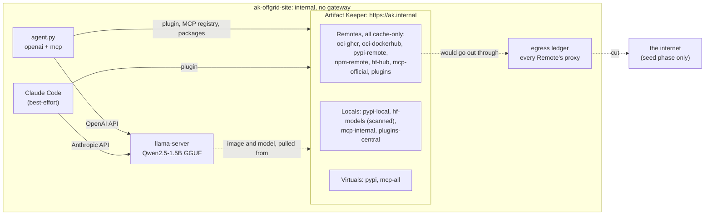

---
tags:
  - preview
  - air-gap
  - AI models
  - AI agents
  - MCP
  - agent plugins
  - Claude Code
  - Hugging Face
  - Python
  - PyPI
  - OCI
  - npm
  - scanning
  - audit
  - TLS
description: >-
  The off-grid AI stack: a local model, MCP tools, agent plugins and every package under them
  from one Artifact Keeper instance; seed it, cut the network, and prove that nothing leaves
  while an agent on the disconnected site still works.
---

# The off-grid AI stack

--8<-- "includes/preview-offgrid.md"

!!! warning "An example, not a complete defense"
    This walkthrough shows one way to run an AI stack from one Artifact Keeper instance and keep
    it working with no route out. The configuration is an example, built and tested in a lab. It
    does not cover every edge case or attack, and it is not a hardened production setup. In
    particular, "nothing leaves" is shown for this lab's containers and this lab's network: the
    proof is only as strong as the network isolation under it, and a scanner finding nothing in
    a model file is not a proof that the model is safe. Some gaps we found are listed in
    [Findings](findings.md). Review and adapt it for your own environment, and use it alongside
    your other controls (network policy, egress firewalls, sandboxed inference, monitoring), not
    instead of them.

This is the last walkthrough of the off-grid AI series. The others each put one layer of an AI
stack behind Artifact Keeper: [the agent's dependencies](../ai-agent-dependency-guardrails/index.md),
[its plugins](../private-agent-plugin-marketplace/index.md), [its MCP tools](../private-mcp-registry/index.md)
and [its models](../private-model-hub/index.md). Here they all run together, from one instance
you own, and then the network is cut:

- **One registry for the whole stack.** The model server's container image, the model, every
  Python package of the agent (each hash-pinned), Acme's own MCP server, a public MCP server
  from the official registry, the agent's plugin, and Claude Code itself.
- **Seed, then disconnect.** Everything the site needs is listed in one manifest and pulled
  through Artifact Keeper while the network is up. The model is seeded at its commit with the
  cache-seed API, then vetted: published to a Local repository where the model-file scanner
  reads it, next to a truncated GGUF and a booby-trapped pickle that do not get through.
- **The cut.** Every Remote goes cache-only, the scheduled upstream jobs pause, and the whole
  stack is recreated on a network with no gateway.
- **An agent that still works.** On that network, a small Python agent installs its plugin
  from Artifact Keeper, starts only the MCP servers the registry lists, and answers a question
  through a tool call to a local model (Qwen2.5-1.5B on llama.cpp, CPU only).
- **Proof that nothing left.** An egress ledger (a logging forward proxy every Remote sends
  its upstream traffic through) gains no connection, the audit log gains no
  `UPSTREAM_FETCHED` row, the cache metrics show only hits, no container has a route out, and
  the inventory read on the site matches the seed's hash for hash. A control proves the
  ledger would have seen an attempt.

Everything runs in containers on one host. The code is in
[`off-grid-ai-stack/`](https://github.com/artifact-keeper/walkthroughs/tree/main/off-grid-ai-stack),
and `make all` followed by `make gates` reproduces the whole thing from an empty registry. No
account anywhere is needed: no Hugging Face token, no API key, no Claude login.

## Who this is for

Teams that want AI tools somewhere the internet is not: a factory floor, a ship, a
classified enclave, a lab that must not leak, or anyone who wants to know exactly what their
AI stack depends on. The questions are: can the whole stack be served from one place we
control? Can we list what it needs, fetch it once and vet it? When the cable is cut, does it
keep working? And can we prove, not just believe, that it does not reach out?

## What you will be able to show

| | Requirement | Where |
|---|---|---|
| R1 | One registry over TLS serves every layer of the stack: images, the model, Python and npm packages, MCP servers, plugins | [Step 1](1-stand-up-the-registry.md), [Step 2](2-seed-the-stack.md) |
| R2 | What the site needs is one manifest; seeding it is one command and leaves an inventory with a hash for every item | [Step 2](2-seed-the-stack.md) |
| R3 | Every upstream request during seeding is on record twice: the egress ledger and the audit log | [Step 2](2-seed-the-stack.md) |
| R4 | The model is vetted before use; a malformed GGUF and a code-executing pickle are flagged and not served | [Step 3](3-vet-what-you-seeded.md) |
| R5 | Scanners keep working offline, with their database carried in through the registry | [Step 3](3-vet-what-you-seeded.md) |
| R6 | The cut is a handful of documented settings plus a network with no gateway | [Step 4](4-disconnect.md) |
| R7 | On the disconnected site an agent installs its plugin, starts only registry-listed MCP servers, and answers through a local model's tool call | [Step 5](5-run-the-agent-offline.md) |
| R8 | Nothing leaves after the cut: no route, no ledger line, no upstream audit row, cache hits only, the same inventory | [Step 7](7-prove-nothing-leaves.md) |
| R9 | What was not seeded fails fast and clearly; nothing waits on an upstream that is not there | [Step 8](8-prove-it-fails-safely.md) |

## The shape of it



While seeding, the same stack sits on `ak-offgrid-seed`, which has a route out, and the
ledger forwards what the Remotes ask for.

## Before you start

- A Linux host with rootless podman 5.x and `podman compose`, curl, jq, openssl, python3
  (3.11 or later) and GNU make. No sudo is needed anywhere.
- An Artifact Keeper backend from `main` at or after `f0d9b638`, or 1.12.0 once released, and a
  scanner adapter image from the same commit (see the
  [code README](https://github.com/artifact-keeper/walkthroughs/tree/main/off-grid-ai-stack#images)).
- About 8 GB of free RAM (the registry stack, llama-server with a 1.5B model, the agent) and
  20 GB of disk. A CPU with AVX2; no GPU.
- Internet access while seeding: container images from docker.io and ghcr.io, packages from
  pypi.org and registry.npmjs.org, the model from huggingface.co and the MCP catalog from
  registry.modelcontextprotocol.io, all through the registry. Without huggingface.co, the
  model checks report `BLOCKED(network)`.
- Loopback port `127.0.0.1:30450` free (change `HTTPS_PORT` in `registry/.env` otherwise).

!!! tip "Run it yourself"
    ```bash
    git clone https://github.com/artifact-keeper/walkthroughs
    cd walkthroughs/off-grid-ai-stack
    make all      # registry, bootstrap, seed, vet, disconnect, agent, claude
    make gates    # the seven gates
    ```
    `SMALL_MODEL=1 make all` uses Qwen2.5-0.5B (491 MB) instead of Qwen2.5-1.5B (1.1 GB).

## Steps

1. [Stand up the registry](1-stand-up-the-registry.md): TLS, every repository, the offline settings set at creation, the egress ledger, users and tokens.
2. [Seed the stack](2-seed-the-stack.md): the manifest, the cache-seed API for the model, the agent image, the MCP catalog, the plugin, the inventory.
3. [Vet what you seeded](3-vet-what-you-seeded.md): the model-file scanner, the offline scanner adapter, the configuration export.
4. [Disconnect](4-disconnect.md): cache-only Remotes, paused jobs, the move to a network with no gateway.
5. [Run the agent offline](5-run-the-agent-offline.md): llama-server, a clean install, the plugin, the MCP registry, a tool call.
6. [Claude Code (best-effort)](6-claude-code-best-effort.md): the plugin from Artifact Keeper and a local model behind the Anthropic API.
7. [Prove nothing leaves](7-prove-nothing-leaves.md): the zero-egress gates G7a to G7e, and the control.
8. [Prove it fails safely](8-prove-it-fails-safely.md): what was not seeded, and every gate of the reference run.

Then [Results](results.md) and [Next steps](next-steps.md) (two instances, the mesh push, and
bundles). The [lab notes](findings.md) are the record every page is written from, including
the Artifact Keeper bugs and gaps we hit. The [original plan](plan.md) is kept as written.
