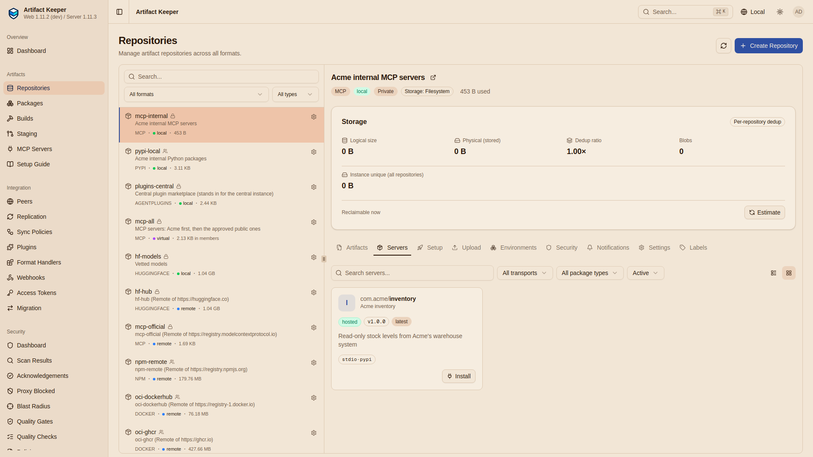
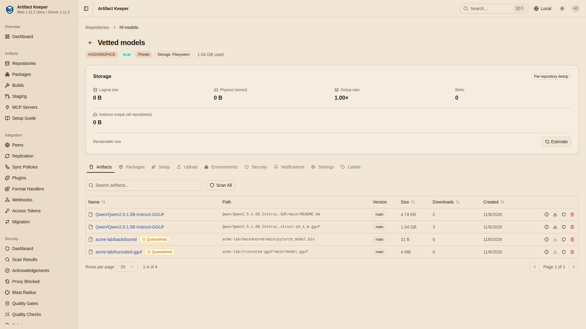
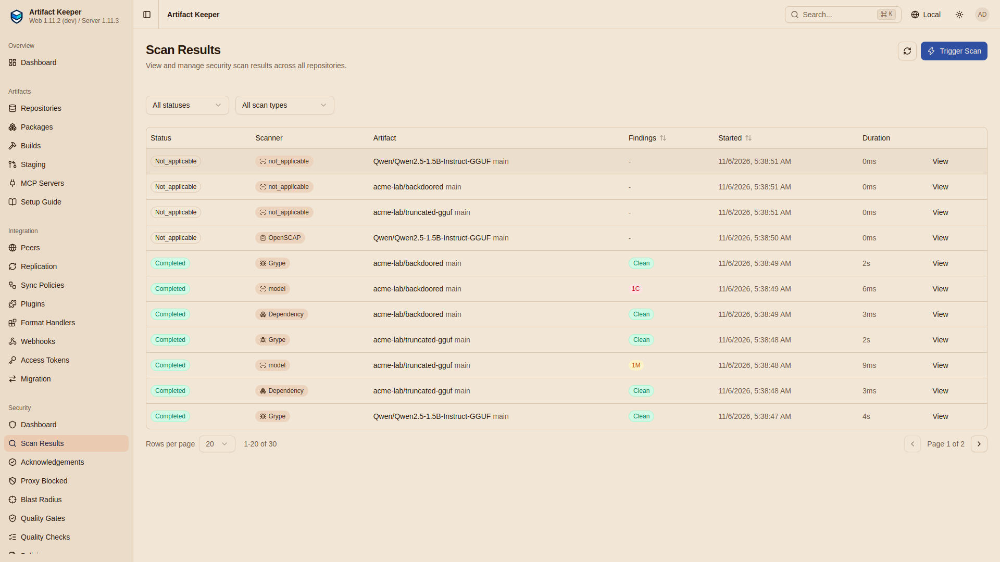
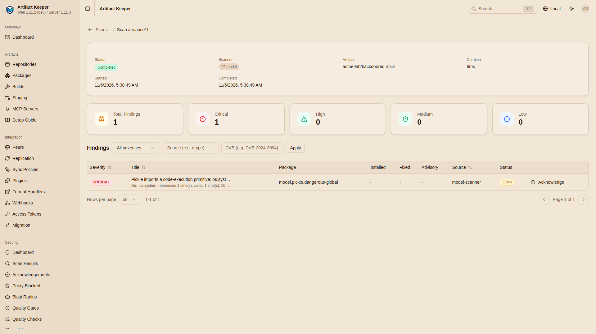
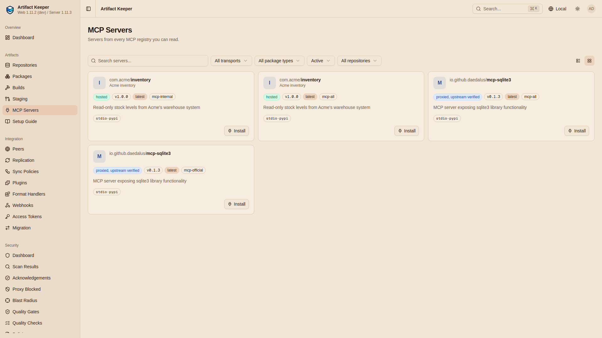
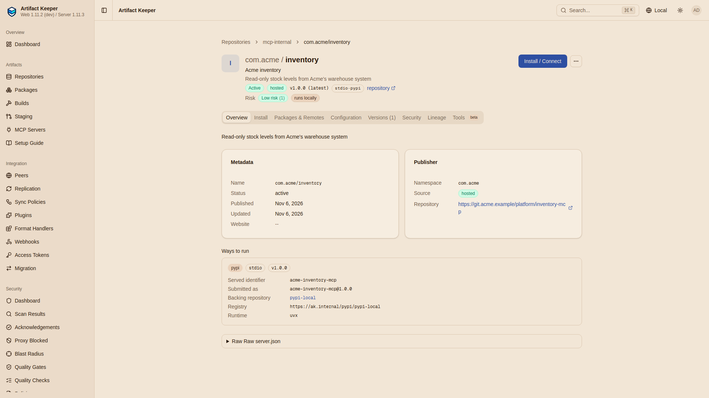
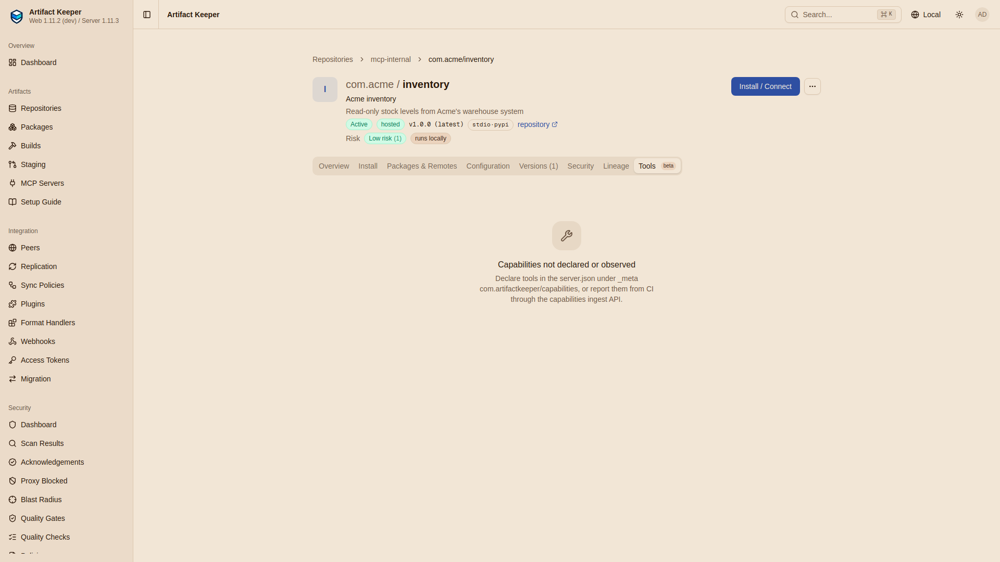
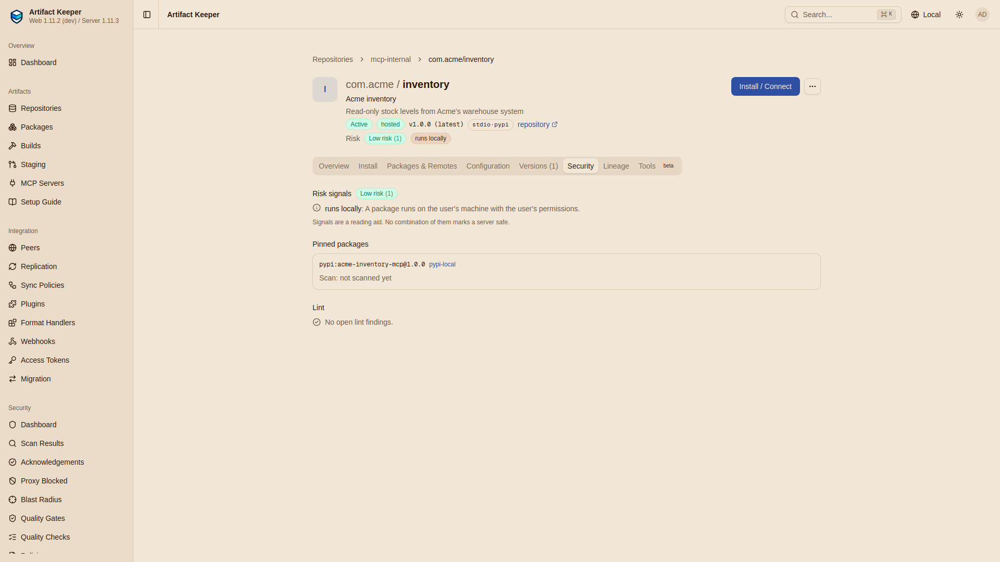
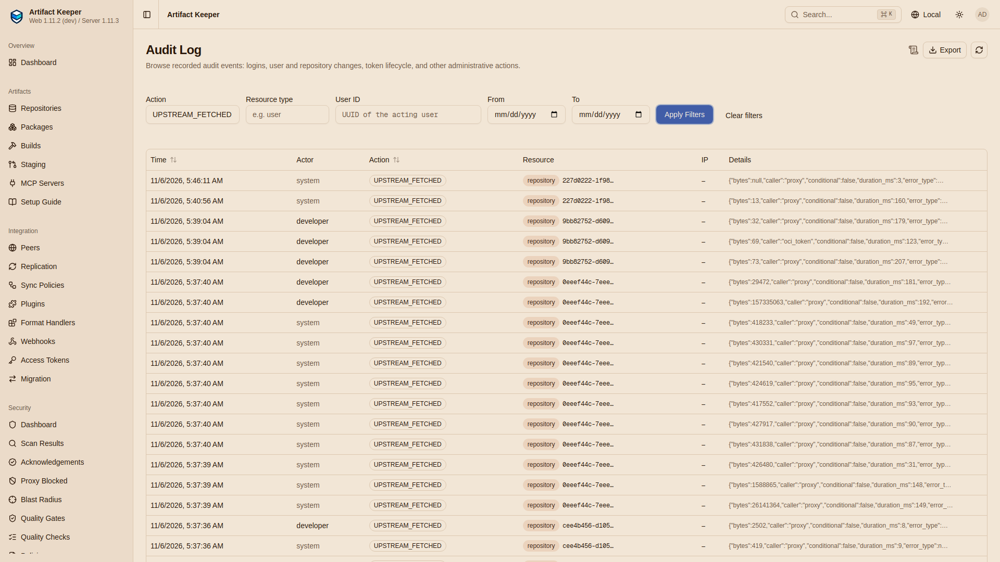
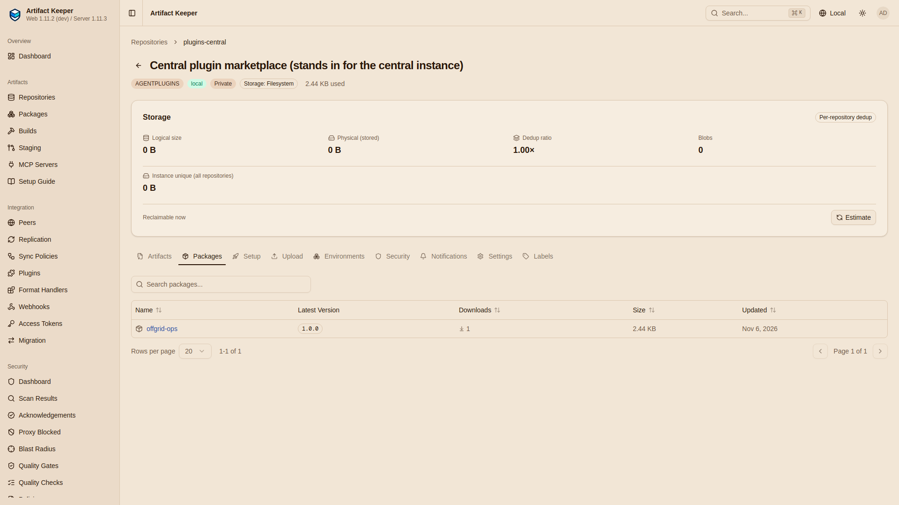

# Results

--8<-- "includes/preview-offgrid.md"

The reference run was on `grace` (Ubuntu 26.04 LTS, kernel 7.0.0-34-generic, 40 cores, 108 GB
RAM, rootless podman 5.7.0 with docker-compose v5.5.0 as the compose provider) on 2026-11-06
(UTC), from a fresh `git clone` of the walkthrough at `de0597c` and an empty registry: `make all`, then
`make gates`. Artifact Keeper: the CI images of `main` at `88f23c51`, pinned by digest
([Step 1](1-stand-up-the-registry.md#images)), reporting 1.11.3. Model Qwen2.5-1.5B-Instruct
Q4_K_M at `91cad51170dc`, llama.cpp `server-b12124`, `openai` 3.46.0, `mcp` 2.3.0,
`huggingface_hub` 2.4.0, `mcp-sqlite3` 0.1.3, Claude Code 2.1.318.

The `SMALL_MODEL=1` run is from the same clone, next to it below. Earlier full runs found two
problems in the walkthrough's own gates, both fixed before this one: a wrong expectation in G6
and a G7 filter that passed on an empty result ([findings](findings.md#what-the-plan-got-wrong)).
The screenshots below come from a third full-size run from the same clone, left up and
disconnected for live capture.

| | Full (Qwen2.5-1.5B) | `SMALL_MODEL=1` (Qwen2.5-0.5B) |
|---|---|---|
| `make all` | 11 min 12 s | 9 min 16 s |
| `make gates` | 2 min 6 s | 1 min 48 s |
| Gates | **73 PASS, 0 FAIL, 0 BLOCKED** of 73 | **71 PASS, 0 FAIL, 1 BLOCKED(best-effort)** of 72 |
| Disk used (growth of the filesystem) | 9.94 GB (9,936,859,136 bytes), with the stack images already in podman's store; 18.95 GB from an empty store in an earlier full run | 7.48 GB (7,484,190,720 bytes), stack images already present |
| Seeding the model with the cache-seed API | 63 s (1.1 GB) | 28 s (491 MB) |
| Pulling the llama.cpp image again on the site | 22 s | 22 s |
| Clean, hash-checked install of the agent's 73 distributions on the site | 73 s | 68 s |
| Clean npm install of Claude Code on the site | 6 s | 6 s |
| The agent, end to end | 10.6 s | 7.3 s |
| Claude Code, minimal prompt, no tools | 3 s, `OFFGRID` | 8 s, echoes its environment prompt |
| Upstream requests (`UPSTREAM_FETCHED`) and ledger connections up to the cut | 283 over 24 | 282 over 22 |

`out/` after a full run is 2.5 GB, mostly the copies of the model.

## The gates

| Gate | Full | `SMALL_MODEL=1` | Time (full) |
|---|---|---|---|
| G1 Seed | 13 PASS | 13 PASS | 1 s |
| G2 Vet | 14 PASS | 14 PASS | 1 s |
| G3 Disconnect | 5 PASS | 5 PASS | 2 s |
| G4 Agent | 11 PASS | 10 PASS (the ref is reported, not gated) | 1 s |
| G5 Claude Code | 3 PASS | 2 PASS, 1 BLOCKED(best-effort) | 0 s |
| G6 Fails safely | 16 PASS | 16 PASS | 12 s |
| G7 Zero egress (G7a-G7e, control) | 11 PASS | 11 PASS | 109 s |

The full list is on [Prove it fails safely](8-prove-it-fails-safely.md#the-reference-run). G7b
and G7d print raw and filtered counts; in the reference run both are 0 (`opened since then: 0`,
`UPSTREAM_FETCHED ...: 0 rows`).

## Against the requirements

| | Requirement | Result |
|---|---|---|
| R1 | One registry over TLS serves every layer of the stack: images, the model, Python and npm packages, MCP servers, plugins | Met (G1, G4, G5) |
| R2 | What the site needs is one manifest; seeding it is one command and leaves an inventory with a hash for every item | Met: 85 items, none missing (G1) |
| R3 | Every upstream request during seeding is on record twice: the egress ledger and the audit log | Met (G1): the ledger's 12 hosts and the audit rows' hosts are the same set. The ledger counts connections (24), the audit log requests (283) |
| R4 | The model is vetted before use; a malformed GGUF and a code-executing pickle are flagged and not served | Met (G2). The scanner reads file structure; it does not judge model behaviour |
| R5 | Scanners keep working offline, with their database carried in through the registry | Met (G2): imported, offline, age reported, the llama.cpp image scanned (689 vulnerabilities listed) |
| R6 | The cut is a handful of documented settings plus a network with no gateway | Met (G3), and the export records every Remote as cache-only |
| R7 | On the disconnected site an agent installs its plugin, starts only registry-listed MCP servers, and answers through a local model's tool call | Met (G4) with both models; G6 shows an unlisted server is refused |
| R8 | Nothing leaves after the cut: no route, no ledger line, no upstream audit row, cache hits only, the same inventory | Met for this lab's containers and network (G7a-G7e, the control, G6's cold `HEAD`s and refused MCP calls) |
| R9 | What was not seeded fails fast and clearly; nothing waits on an upstream that is not there | Met (G6): every unseeded item is a 404 in under 400 ms, and the MCP seed and sync are 409s that say why |

## Artifact Keeper issues found

Each was found in a debug run on `main` at `0bffa44c`, fixed on `main`, and verified in the
reference run.

| | Kind | Summary | Fixed by |
|---|---|---|---|
| [F1](findings.md#f1-an-mcp-remote-synced-before-its-settings-applied) | bug | An MCP Remote synced the moment it was created, before its egress proxy could be set ([#5402](https://github.com/artifact-keeper/artifact-keeper/issues/5402)) | [#5406](https://github.com/artifact-keeper/artifact-keeper/pull/5406), `c2816e4c` |
| [F2](findings.md#f2-a-manual-mcp-sync-was-cut-off-by-the-request-timeout) | bug | A manual MCP sync ran inline and was cut off by the 120 s request timeout, as a 503 "Server overloaded" ([#5404](https://github.com/artifact-keeper/artifact-keeper/issues/5404)) | [#5405](https://github.com/artifact-keeper/artifact-keeper/pull/5405), `c09e5d7e` |
| [F3](findings.md#f3-a-remote-learned-a-name-only-by-syncing-the-whole-catalog) | gap | An MCP Remote could not pin or seed a named server version without a full catalog sync ([#5408](https://github.com/artifact-keeper/artifact-keeper/issues/5408)) | [#5409](https://github.com/artifact-keeper/artifact-keeper/pull/5409), `88f23c51` |
| [F4](findings.md#f4-config-export-did-not-carry-the-upstream-mode) | gap | Config export did not carry a Remote's upstream mode ([#5407](https://github.com/artifact-keeper/artifact-keeper/issues/5407)) | [#5415](https://github.com/artifact-keeper/artifact-keeper/pull/5415), `d9a417c8` |
| [F5](findings.md#f5-the-cold-head-probe-was-not-audited) | bug | The cold-HEAD upstream probe was not an `UPSTREAM_FETCHED` row ([#5347](https://github.com/artifact-keeper/artifact-keeper/issues/5347)) | [#5414](https://github.com/artifact-keeper/artifact-keeper/pull/5414), `a2f53502` |

## The web UI

Screenshots of the web UI (1920x1080, light theme), taken by
[`demo/shoot.sh`](https://github.com/artifact-keeper/walkthroughs/blob/main/off-grid-ai-stack/demo/shoot.sh)
from a browser on the site network, on the third full-size run from the same clone, after the
cut. Nothing in the walkthrough depends on the UI.

The list shows `remote` but not `cache_only` for any Remote: the UI does not show a Remote's
upstream mode yet ([artifact-keeper-web#1094](https://github.com/artifact-keeper/artifact-keeper-web/issues/1094)).
The storage panel also reads "Logical size 0 B" next to sizes like "1.04 GB" in the list
([findings](findings.md#behaviour-worth-knowing)).

The pinned package shows "not scanned yet": `pypi-local` has no scan on upload in this
walkthrough; only `hf-models` does.

The audit page filters by day, not by time, so the rows before the cut are on the same page.
The one row after the cut, 5:46:11 (actor `system`, `error_type` `connect`), is the negative
control of the first gate run on that stack ([Step 7](7-prove-nothing-leaves.md#the-control-poke-a-hole-then-seal-it)).

