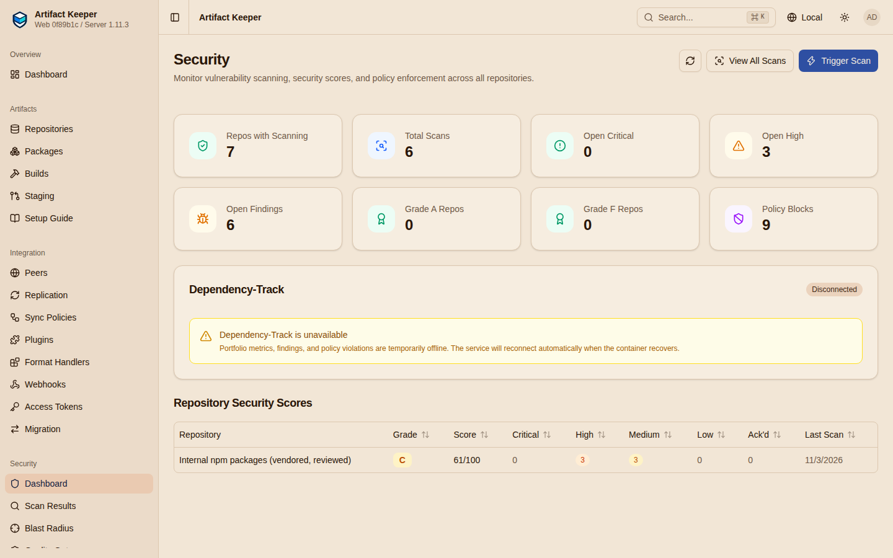
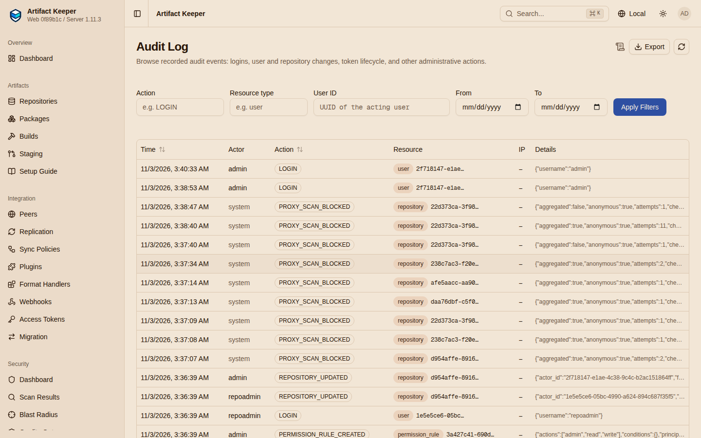
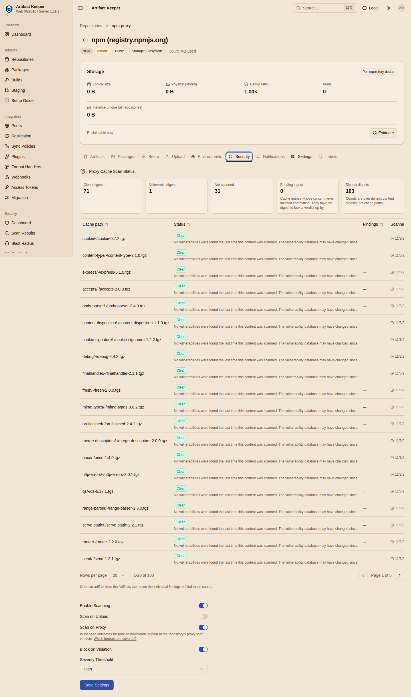

# Step 3: Review the dashboard and the queues

!!! danger "Draft, run against `main`"
    Output on this page is from the run of 2026-11-03 against the Artifact Keeper `main`
    image (revision `12808b8`), pending a re-run on the 1.12.0 candidate. See [Results](results.md).

Where the operator looks, before and after the gate enforces. This page shows the views as
they read once [Step 4](4-enforce.md) has switched the five proxies to `fail_closed`; under
record-only every "blocked" number on it is zero, and the preview of [Step 2](2-record-first.md)
is the only view that says anything. That asymmetry is itself a finding (F2 in
[Findings](findings.md)): the record-only pass has no dashboard of its own.

**Make target:** `make review`, which runs
[`policy/review.sh`](https://github.com/artifact-keeper/walkthroughs/blob/main/one-gate-every-package-manager/policy/review.sh).

## The dashboard

```console
$ make review
== GET /api/v1/security/dashboard
{
  "repos_with_scanning": 6,
  "total_scans": 0,
  "total_findings": 0,
  "critical_findings": 0,
  "high_findings": 0,
  "policy_violations_blocked": 8,
  "proxy_blocked": 8,
  "repos_rated": 0,
  "repos_incomplete": 0,
  "repos_unrated": 0
}
```

`proxy_blocked` is new in 1.12.0: the distinct proxied digests that some repository's gate
refuses right now. `policy_violations_blocked` keeps its older meaning (hosted artifacts a scan
policy refuses, plus these). The other counters are about hosted scans, and this registry has
none yet; `total_scans: 0` next to `proxy_blocked: 10` is the clearest statement of what the
dashboard counts: proxy verdicts are not "scans" in the sense of the scan list, and the
repository scores (`repos_rated` and so on, [grade status](https://github.com/artifact-keeper/artifact-keeper/blob/main/docs/security/grade-status.md)
since 1.12.0) are computed for hosted repositories only. `GET /api/v1/security/scores`
returns `[]` until [Step 5](5-handle-an-exception.md) puts an artifact into `npm-internal`.
`total_scans: 0` next to `proxy_blocked: 8` says it plainly.



The web UI's dashboard (Security, Dashboard) shows the same numbers; "Policy Blocks" is
`policy_violations_blocked`. It has no card for `proxy_blocked` yet and no list of the
refused proxied files (the web follow-ups for the 1.12.0 backend work are not in this build).

## The blocked list

```console
== GET /api/v1/security/proxy-blocked   (instance admin; what every proxy refuses right now)
alpine-proxy  critical  41 findings  CVE-2026-10536,CVE-2026-11856,CVE-2026-18924  v3.22/main/x86_64/curl-8.14.1-r4.apk
cargo-proxy   critical  1 findings   CVE-2021-25900                                api/v1/crates/smallvec/1.6.0/download
debian-proxy  critical  38 findings  CVE-2026-10536,CVE-2026-11856,CVE-2026-18924  pool/main/c/curl/curl_7.88.1-10+deb12u15_amd64.deb
debian-proxy  high      4 findings   CVE-2026-32316,CVE-2024-23337,CVE-2025-9403   pool/main/j/jq/jq_1.6-2.1+deb12u2_amd64.deb
debian-proxy  critical  9 findings   CVE-2026-6653,CVE-2026-74860,CVE-2026-86138   pool/main/libx/libxml2/libxml2_2.9.14+dfsg-1.3~deb12u6_amd64.deb
go-proxy      high      4 findings   CVE-2026-56851,CVE-2026-56852,CVE-2026-56864  golang.org/x/text/@v/v0.21.0.zip
go-proxy      high      5 findings   CVE-2021-38561,CVE-2022-32149,CVE-2026-56851  golang.org/x/text/@v/v0.3.0.zip
npm-proxy     high      6 findings   CVE-2020-8203,CVE-2021-23337,CVE-2026-4800    lodash/-/lodash-4.17.15.tgz
```

(Abridged to the columns that matter; the script prints the first three CVE ids.) One list across every repository, the
CVE ids most severe first, the digest alongside (`checksum_sha256` in the JSON), and two
filters, `repository` and `min_severity`. It lists only what each repository's own settings
refuse: a record-only repository, or a repository whose threshold is above the verdict,
contributes nothing, which is why this list is empty during [Step 2](2-record-first.md). It needs
an instance administrator with an unrestricted credential.

## The admin hold queues

```console
== GET /api/v1/admin/holds/summary
{"age_gate_pending":0,"quarantine_active":0,"quarantine_rejected":0}
== GET /api/v1/admin/holds/policy-blocks   (proxy-cache items first, then hosted)
proxy-cache  alpine-proxy  critical  v3.22/main/x86_64/curl-8.14.1-r4.apk
proxy-cache  cargo-proxy   critical  api/v1/crates/smallvec/1.6.0/download
proxy-cache  debian-proxy  critical  pool/main/c/curl/curl_7.88.1-10+deb12u15_amd64.deb
proxy-cache  debian-proxy  high      pool/main/j/jq/jq_1.6-2.1+deb12u2_amd64.deb
proxy-cache  debian-proxy  critical  pool/main/libx/libxml2/libxml2_2.9.14+dfsg-1.3~deb12u6_amd64.deb
proxy-cache  go-proxy      high      golang.org/x/text/@v/v0.21.0.zip
proxy-cache  go-proxy      high      golang.org/x/text/@v/v0.3.0.zip
proxy-cache  npm-proxy     high      lodash/-/lodash-4.17.15.tgz
```

The queues under `/api/v1/admin/holds` (1.12.0, #4281) are the operator's work list:
`summary` counts age-gate reviews and quarantine holds, `quarantine` lists holds by source,
and `policy-blocks` lists what the download gate's scan-policy decision refuses right now,
proxied content first (the same items as the blocked list, with `source: proxy-cache`) and
then hosted artifacts (none yet). The hosted half is paged by cursor because it has to
evaluate each candidate; `evaluated` in the response says how many it looked at on this page.
After [Step 5](5-handle-an-exception.md) the vendored `lodash` appears in the hosted half.

## The audit: who asked

```console
== GET /api/v1/admin/audit   (PROXY_SCAN_BLOCKED rows: who asked for what)
2026-11-03T03:36:14Z  anonymous  -  alpine-proxy  attempts=1  curl-8.14.1-r4.apk
2026-11-03T03:36:13Z  anonymous  -  debian-proxy  attempts=1  libxml2_2.9.14+dfsg-1.3~deb12u6_amd64.deb
2026-11-03T03:36:09Z  anonymous  -  npm-proxy     attempts=1  lodash-4.17.15.tgz
2026-11-03T03:36:08Z  anonymous  -  cargo-proxy   attempts=1  smallvec-1.6.0.crate
2026-11-03T03:36:07Z  anonymous  -  go-proxy      attempts=1  v0.3.0.zip
```

Every `403 scan_blocked` writes a `PROXY_SCAN_BLOCKED` audit row (1.12.0, #4969) with the
repository, the path, the digest, the verdict, the principal, and an `attempts` counter:
refusals of one digest by one principal are aggregated per minute, so the first refusal is
written at once and the retries inside the window become one summary row when it closes
(`attempts=1` here: the five known-bad pulls, one row each, a minute after
[Step 4](4-enforce.md) ran them). [Step 6](6-prove-it-fails-safely.md) measures the
aggregation with a retry loop.

Two honest limits of this run. The principal is `anonymous` because the five proxies are
public and the clients send no credential ([Step 1](1-stand-up-the-registry.md)); with
per-client tokens, as in the other walkthroughs, the row names the token's user. And the
`ip_address` column of these rows is `null`, although the backend's request log for the same
pull records the client address; the audit documentation says the row carries the verified
client IP. That is finding F4 in [Findings](findings.md). The row is still enough to answer
"what was asked for, from which repository, how often".



## Per repository

The repository page of a Remote has a Security tab with the proxy-scan panel: the summary
counts (clean, vulnerable, not scanned), each cached file with its verdict, and the findings
of a vulnerable one. This is the UI form of the preview in [Step 2](2-record-first.md) and the
one place in this build of the web UI that shows a proxied verdict.



**Gate:** G6 (refusals are listed in the blocked list, counted on the dashboard, queued under
`admin/holds/policy-blocks`, and audited with the repository named).

**Next:** [Step 4: Enforce](4-enforce.md).
