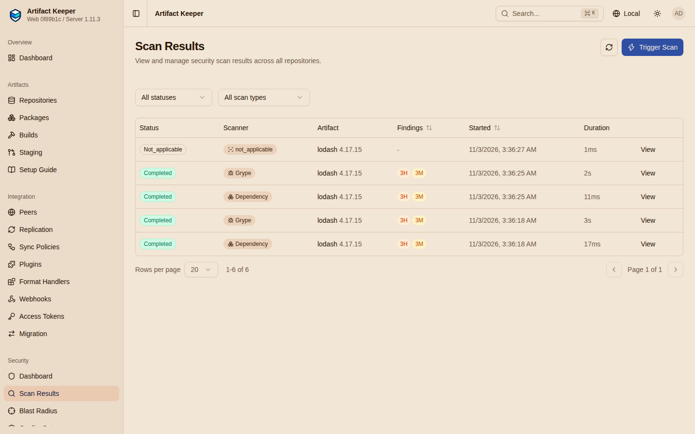

# Step 5: Handle a legitimate exception

!!! danger "Draft, run against `main`"
    Output on this page is from the run of 2026-11-03 against the Artifact Keeper `main`
    image (revision `12808b8`), pending a re-run on the 1.12.0 candidate. See [Results](results.md).

A gate that cannot say "yes, we know, let it through" is turned off by the first deadline.
This page shows the two kinds of exception a team meets in the first month: a package the
team needs and has decided to accept, and a package the scanner is wrong about. The first
has a path through the hosted side; the second has none today, and the page says so.

**Make targets:** `make vendor acknowledge release rescan proxied` (or `make exception` for
all five).

## The one we accept: vendor it, acknowledge, release

A legacy application pins `lodash 4.17.15`. The findings are real (prototype pollution and
command injection in functions the application does not call), the team has reviewed them,
and the upgrade is a quarter away. The proxy refuses the tarball since [Step 4](4-enforce.md),
and a proxied verdict cannot be acknowledged (#5152). The hosted side can: the team vendors
the package into `npm-internal`, where the scan policy from [Step 1](1-stand-up-the-registry.md)
applies and findings can be acknowledged one by one, with a reason and an actor.

[`exception/vendor.sh`](https://github.com/artifact-keeper/walkthroughs/blob/main/one-gate-every-package-manager/exception/vendor.sh)
publishes the tarball `npm pack` saved during the record-only pass, with the CI token for
`npm-internal`, and waits for the upload scan:

```console
$ make vendor
+ lodash@4.17.15
vendor: waiting for the upload scan of 64f0b43c-2d09-496a-8086-eb88e298e48c . completed
vendor: scan 218e2500-6391-4ff8-8770-640621ee8be7: {"scan_type":"grype","status":"completed","grade_status":"rated","findings_count":6,"critical_count":0,"high_count":3,"vuln_db_version":"grype-db-v6.1.10"}
grype       218e2500-6391-4ff8-8770-640621ee8be7  6 findings  grade_status=rated
dependency  fb0e38e4-5272-48d3-a494-4d3331424254  6 findings  grade_status=rated
  grype    high    CVE-2021-23337  lodash@4.17.15  fixed=4.17.21  acknowledged=false
  grype    high    CVE-2020-8203   lodash@4.17.15  fixed=4.17.19  acknowledged=false
  grype    high    CVE-2026-4800   lodash@4.17.15  fixed=4.18.0   acknowledged=false
  grype    medium  CVE-2020-28500  lodash@4.17.15  fixed=4.17.21  acknowledged=false
  grype    medium  CVE-2025-13465  lodash@4.17.15  fixed=4.17.23  acknowledged=false
  grype    medium  CVE-2026-2950   lodash@4.17.15  fixed=4.18.0   acknowledged=false
  osv.dev  high    CVE-2021-23337  lodash@4.17.15  fixed=4.17.21  acknowledged=false
  … (the dependency scan repeats the same six)
vendor: download through npm-internal: HTTP 403
```

Two scanners ran on the upload, Grype and the registry's own dependency scan (`osv.dev`),
and both wrote the same six CVEs as separate rows. The scan policy (`max_severity: high`)
found three at or above `high`, quarantined the artifact, and the download answers `403`:
the hosted gate's answer for "held by a scan policy" (1.12.0 made that `403` rather than
`409`, so a client stops waiting for a release that will not come). The repository now has a
score, which is what the 1.12.0 grade status is about: `grade_status: rated`,
`coverage: 1 of 1 cataloged` (`GET /api/v1/security/scores` was `[]` until this upload).



Then the decision, as a record:

```console
$ make acknowledge
acknowledge: grype CVE-2021-23337 acknowledged by 2f718147-e1ae-4c38-9c4c-b2ac151864ff at 2026-11-03T03:36:24.391613Z
acknowledge: grype CVE-2020-8203 acknowledged by 2f718147-… at 2026-11-03T03:36:24.474160Z
…
acknowledge: osv.dev CVE-2025-13465 acknowledged by 2f718147-… at 2026-11-03T03:36:25.075647Z
acknowledge: 12 finding(s) acknowledged with reason: legacy-app: lodash is only used for _.get on trusted config; prototype pollution not reachable; ticket SEC-421
acknowledge: quarantine: {"quarantine_status":"quarantined","quarantine_reason":"Policy 'npm-internal-gate': 3 findings at or above high severity","is_blocked":true}
acknowledge: download through npm-internal: HTTP 409
```

`POST /api/v1/security/findings/{id}/acknowledge` with `{"reason": …}`, once per row:
twelve rows for six CVEs, because two scanners wrote them. The policy no longer refuses the artifact, and the answer changes from
`403` to `409`: the quarantine hold the scanner wrote is still there, and a hold with no
recorded source falls back to the plain quarantine answer once the policy passes (finding F5
in [Findings](findings.md)). An administrator releases it:

```console
$ make release
release: before: {"quarantine_status":"quarantined","is_blocked":true}
release: {"artifact_id":"64f0b43c-2d09-496a-8086-eb88e298e48c","new_status":"released","message":"Artifact released from quarantine"}
release: after:  {"quarantine_status":"released","is_blocked":false}
release: download through npm-internal: HTTP 200
release: npm-internal score: {"grade":"A","grade_status":"rated","score":100,"coverage":{"artifacts":1,"scanned":1,"cataloged":1,"partial":0,"failed":0,"uncataloged":0,"coverage_pct":100},"acknowledged_count":6}
```

Acknowledge, then release, then the legacy application installs `lodash` from
`npm-internal` while every other project keeps getting `403` from `npm-proxy`. The reason
and the actor are on every acknowledged row; the audit log has the release. The score moved
from `C` (61) to `A` (100) with `acknowledged_count: 6`: acknowledged findings do not count
against the grade, and the grade status stays `rated` because the artifact was fully
assessed.

## What the acknowledgement does not survive (#5153)

A scanner database update rescans hosted artifacts. Here the rescan is forced:

```console
$ make rescan
rescan: {"message":"Scan queued for artifact 64f0b43c-…","artifacts_queued":1,"scan_result_ids":["1f0ee05e-…","1cc3eb84-…","92cb6ad4-…"]}
rescan: new Grype scan 1cc3eb84-086d-4e0b-8618-b20f8343a3ac: {"status":"completed","findings_count":6,"acknowledged_count":null}
  grype    high    CVE-2020-8203   lodash@4.17.15  acknowledged=false
  grype    high    CVE-2021-23337  lodash@4.17.15  acknowledged=false
  grype    high    CVE-2026-4800   lodash@4.17.15  acknowledged=false
  …
  osv.dev  high    CVE-2020-8203   lodash@4.17.15  acknowledged=false
  …
rescan: quarantine: {"quarantine_status":"quarantined","quarantine_reason":"Policy 'npm-internal-gate': 3 findings at or above high severity","is_blocked":true}
rescan: download through npm-internal: HTTP 403
```

`POST /api/v1/security/scan` with `{"artifact_id": …, "bypass_dedup": true}` (admin only).
The new scans write the same six CVEs as new, unacknowledged rows; the policy counts them,
quarantines the artifact again, the download is refused again, and the repository's grade
drops back to `C` (the dashboard screenshot in [Step 3](3-review-the-queues.md) was taken
after this). The acknowledgement was
stored on the old rows, not on the decision. That is open issue #5153, planned for 1.12.0:
acknowledgements keyed by CVE and component that keep applying across rescans, dedup copies
and promotion. Until it lands, gate G7 reports `BLOCKED(#5153)`, and a team should keep its
reasons in a ticket and expect to acknowledge again after each scanner update.

## The one the scanner is wrong about: no exception today (#5143)

`taplo-cli` depends on `async-ctrlc 1.2.0`. The crate's author published it with their
`Cargo.lock` inside the archive, and the scanner grades every entry of that lockfile as if a
consumer installed it:

```console
$ make proxied
proxied: cargo fetch of a project depending on async-ctrlc 1.2.0
error: failed to download from `https://ak.internal/cargo/cargo-proxy/api/v1/crates/async-ctrlc/1.2.0/download`
  {"error":"scan_blocked","file":"async-ctrlc-1.2.0.crate","reason":"blocked by inline vulnerability scan policy"}
proxied: what the verdict is made of (proxy-scan record, findings by component):
  state=vulnerable severity=critical findings=11 cataloged=66
    critical  CVE-2021-32810       crossbeam-deque@0.7.3    fixed=0.7.4
    high      CVE-2020-35906       futures-task@0.3.5       fixed=0.3.6
    high      CVE-2022-23639       crossbeam-utils@0.7.2    fixed=0.8.7
    high      GHSA-9g55-pg62-m8hh  crossbeam-channel@0.4.2  fixed=0.4.3
    high      GHSA-wgrg-5h56-jg27  nix@0.17.0               fixed=0.20.2
    medium    …
proxied: the crate's own bundled lockfile is where those packages come from:
    async-ctrlc-1.2.0/Cargo.lock
    name = "crossbeam-deque"   version = "0.7.3"
    name = "crossbeam-utils"   version = "0.7.2"
    name = "futures-task"      version = "0.3.5"
    name = "nix"               version = "0.17.0"
```

Not one of the eleven findings is against `async-ctrlc`; `cataloged=66` says the scanner
graded sixty-six packages for a crate whose consumers resolve their own graph. A dependent
never installs those versions. This is open issue #5143, planned for 1.12.0 (grade a crate on
its own coordinate, or filter findings to it); gate G8 reports `BLOCKED(#5143)`.

What a team can do today, in the order the walkthrough would try them:

1. **Nothing on the proxied side.** A proxied verdict has no acknowledgement (#5152), the
   rescan endpoint re-grades the same bytes the same way, and the verdict is keyed by digest,
   so it follows the file into every repository that serves it.
2. **Vendor it**, as above: publish the `.crate` to a hosted Cargo repository, acknowledge,
   release. For Cargo that means the `cargo publish` wire format rather than a file upload,
   which this walkthrough did not script.
3. **Loosen the one repository**: `critical` as the threshold on `cargo-proxy` would not
   help here (the lead finding is critical); `record_only` on `cargo-proxy` would, at the
   price of the whole proxy. The lock from [Step 4](4-enforce.md) means that is an instance
   administrator's decision, made in the open.

The same three options are what a Debian or Alpine team has for `curl` ([Step 4](4-enforce.md),
finding F3), with the second one needing an `apt`/`apk` hosted repository instead.

**Gates:** G7 (hosted: refused, acknowledged, released, served; refused again after the
rescan, `BLOCKED(#5153)`), G8 (proxied: graded on its own coordinate, `BLOCKED(#5143)`).

**Next:** [Step 6: Prove it fails safely](6-prove-it-fails-safely.md).
