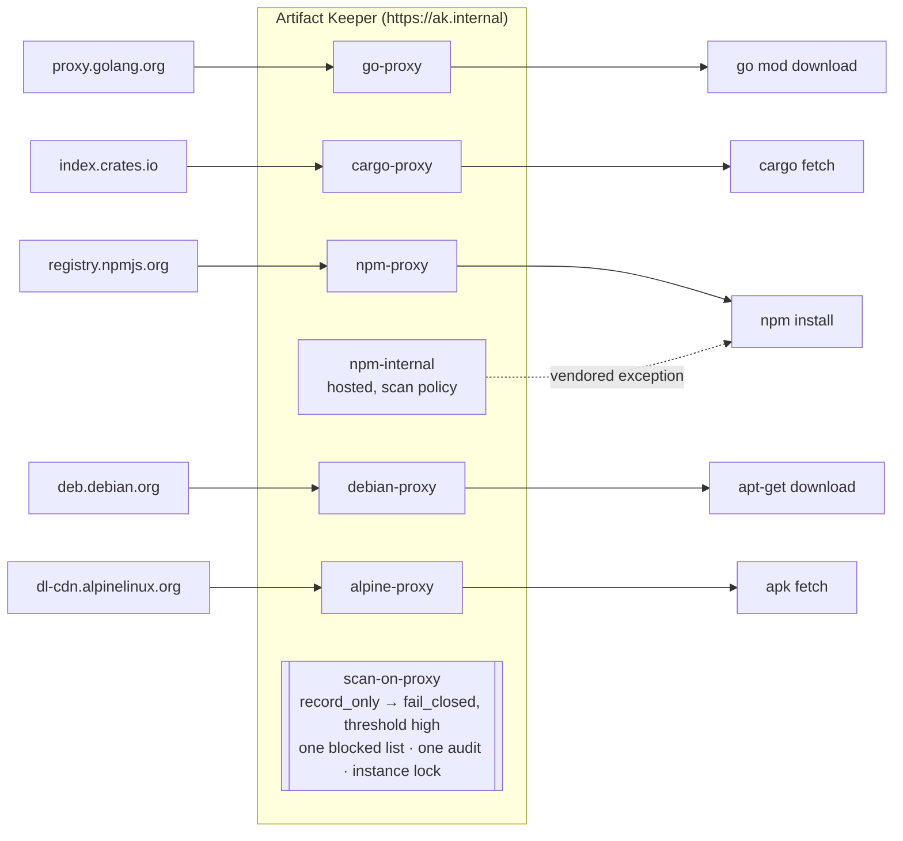

---
tags:
  - Go
  - Cargo
  - npm
  - Debian
  - Alpine
  - scan-on-proxy
  - vulnerability scanning
  - record-only
  - rollout
  - audit
  - supply chain
description: >-
  One scan gate in front of go, cargo, npm, apt and apk on Artifact Keeper, rolled out without
  breaking a build: record first, see what would be blocked, review the queues, enforce and
  lock, handle an exception, prove it fails closed.
---

# One gate for every package manager

!!! warning "An example, not a complete defense"
    This walkthrough shows one way to put Artifact Keeper's proxy scan gate in front of several
    package managers. The configuration is an example, built and tested in a lab. It does not
    cover every edge case or attack, and it is not a hardened production setup. Some gaps we
    found are listed in [Findings](findings.md). Review and adapt it for your own environment,
    and use it alongside your other controls, not instead of them.

!!! danger "Draft: run against `main`, pending a re-run on the 1.12.0 candidate"
    Artifact Keeper 1.12.0 is not released. Every page was written from a run against the
    `main` image of 2026-11-02 (revision `12808b8`, digest in [Results](results.md)). Seven
    fixes planned for 1.12.0 are not merged; the [plan](plan.md) names which step waits on
    which, and the gates report them as `BLOCKED(#issue)`. Output quoted on the pages is what
    that run printed. The pages will be re-run and re-checked on a 1.12.0 release candidate
    before this draft is published.

A company with more than one language has more than one package manager, and every one of
them pulls from the public internet through the artifact registry. The security team wants
known-vulnerable packages stopped at the registry. The platform team knows what happens when a
gate is switched on in one step: builds break in every language at once, nobody can tell which
refusal was intended, and the gate is turned off again by lunchtime.

This walkthrough puts one gate, Artifact Keeper's scan-on-proxy, in front of five package
managers (`go`, `cargo`, `npm`, `apt` and `apk`) and rolls it out the way a team can live with:

1. **Record first.** The gate scans and records every pull and withholds nothing.
2. **Review** what would have been refused, per file and per advisory, on the dashboard and in
   the admin queues.
3. **Enforce**, fail closed, and lock the policy so nobody weakens it under pressure.
4. **Handle a legitimate exception** with a recorded reason.
5. **Prove it fails safely**: inconclusive is refused, side doors are shut, a retry loop
   cannot flood the audit.

Everything runs in containers on one host. The code is in
[`one-gate-every-package-manager/`](https://github.com/artifact-keeper/walkthroughs/tree/main/one-gate-every-package-manager)
and `make all` reproduces it from an empty registry; the timings are in [Results](results.md).

!!! note "Registry version"
    The walkthrough targets **Artifact Keeper 1.12.0**, which brings the gate to Go, Debian
    and Alpine (and seven more formats), adds the `record_only` mode, the cross-repository
    blocked list, the audit row per refusal, the admin hold queues, grade status instead of
    F floors, and the instance-admin lock. The run behind these pages used `main`
    (revision `12808b8`); see the draft notice above.

## Who this is for

A platform or security team that owns the registry for several languages and has to turn on
blocking without being the reason builds fail. The questions are practical: what will be
refused, who asked for it, how do I let one through with a reason, and what happens when the
scanner cannot decide.

## What you will see

| | The question | The answer, in this walkthrough | Where |
|---|---|---|---|
| R1 | Is it one policy for every format? | `PUT /api/v1/repositories/{key}/security` with the same four fields on all five proxies | [Step 2](2-record-first.md) |
| R2 | Can I see what would be refused before refusing anything? | `record_only`, then the per-repository proxy-scan record filtered by severity | [Step 2](2-record-first.md) |
| R3 | Where do I look once it enforces? | the dashboard counter, the cross-repository blocked list, the admin hold queue, one audit row per refusal | [Step 3](3-review-the-queues.md) |
| R4 | Does enforcing break the ordinary build? | the fixed baselines pass in four formats; npm waits on #5149 | [Step 4](4-enforce.md) |
| R5 | Can a repository admin turn it back off? | not once an instance admin locks it: tighten yes, weaken 403 | [Step 4](4-enforce.md), [Step 6](6-prove-it-fails-safely.md) |
| R6 | How do I let one package through? | hosted: acknowledge each finding with a reason (and what it does not survive, #5153); proxied: no exception yet (#5143, #5152) | [Step 5](5-handle-an-exception.md) |
| R7 | What happens when the scanner cannot decide? | `423 scan_pending`, never unscanned bytes; the generic route refuses; the audit is aggregated | [Step 6](6-prove-it-fails-safely.md) |

## The shape of it



Each client runs in its official image on the registry's network, with the stack's CA and a
configuration that names only `ak.internal` (`GOPROXY`, Cargo source replacement, `.npmrc`,
an apt `.sources` file, `/etc/apk/repositories`). Every command is download-only: nothing from
a package is installed into an image or executed. The "ordinary day" is a small project per
format; the "known-bad" is one old release with public advisories per format, chosen so that
nothing malicious is ever fetched.

## Before you start

- A Linux host with rootless podman 5.x and `podman compose` backed by docker-compose 2.24 or
  newer, with the user podman socket on (`systemctl --user enable --now podman.socket`).
- bash 4+, curl, jq, openssl, GNU make and `column`. No sudo.
- About 6 GB of free RAM and 10 GB of disk; internet access for the registry's five upstreams
  and for the image pulls.
- A free subnet `172.31.60.0/24` and a free port `127.0.0.1:30446`, or change both in
  `registry/.env`.

!!! tip "Run it yourself"
    ```bash
    git clone https://github.com/artifact-keeper/walkthroughs
    cd walkthroughs/one-gate-every-package-manager
    make all          # registry, proxies, record-only, baselines, preview, enforce, lock,
                      #   baselines again, review, exception
    make gates        # G1-G9, evidence in out/gates/
    make screens-ready
    ```
    `make help` lists the step-by-step targets the pages use one at a time. `make clean`
    deletes the stack, its volumes, the tokens and `registry/.env`.

## Steps

1. [Stand up the registry and the five clients](1-stand-up-the-registry.md): the stack, five Remote repositories, one client configuration per package manager.
2. [Record first](2-record-first.md): `record_only` on all five, the ordinary pulls and the known-bad ones, and the preview of what would be refused.
3. [Review the dashboard and the queues](3-review-the-queues.md): what the operator sees, in the API and the web UI.
4. [Enforce](4-enforce.md): fix what the preview flagged, `fail_closed`, lock the policy, and run the builds again.
5. [Handle a legitimate exception](5-handle-an-exception.md): the vendored package, the acknowledgement, the rescan (#5153); the proxied false positive (#5143).
6. [Prove it fails safely](6-prove-it-fails-safely.md): inconclusive, the generic route, the lock, the audit flood, the refused file in the cache.

Then [Results](results.md), [Findings](findings.md) and [Next steps](next-steps.md). The
[plan](plan.md) is the design we started with.

## Terms used here

- **Remote repository:** a caching proxy for a public upstream (`go-proxy` for proxy.golang.org).
- **Proxy scan gate (scan-on-proxy):** the registry scans each file it fetches from the
  upstream and decides, per file, to serve or refuse it. Verdicts are keyed by the file's
  SHA-256 and shared by every repository that serves the same bytes.
- **`record_only`, `fail_open`, `fail_closed`:** the three actions. Record-only never
  withholds; fail-open serves a first pull while it is scanned and refuses known-vulnerable
  bytes afterwards; fail-closed serves nothing before a verdict exists.
- **Inconclusive:** the scanner could not grade the file (over the size cap, out of budget,
  an identity mismatch, a release it cannot determine). `423 scan_pending` under fail-closed.
- **Instance lock:** a flag an instance administrator sets on a repository's scan policy; a
  repository administrator can then tighten it but not weaken it.
