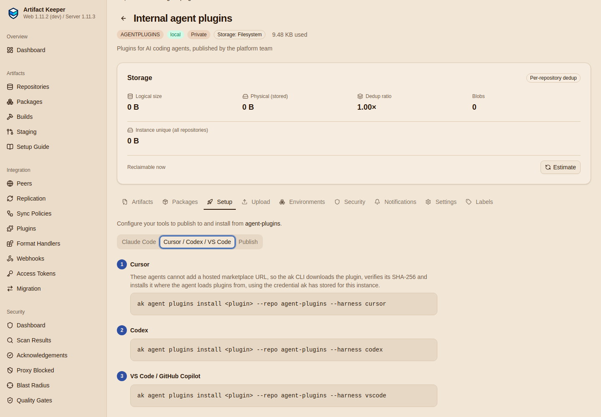

# Step 5: Install in Cursor, Codex and Copilot

--8<-- "includes/preview-1.12.md"

None of these three accepts a hosted marketplace URL today. Cursor's team marketplaces import
git repositories, `codex plugin marketplace add` takes a git URL or a local directory, and
`copilot plugin install` takes a marketplace, a repository or a local path. So the developer
installs with `ak`, which does the registry's half of a marketplace on the machine: it reads
`<name>/index.json`, downloads the zip, checks its SHA-256 against the index, refuses entries
that would land outside the plugin, unpacks it where the agent looks, and tells the agent.

[`make consume-cli`](https://github.com/artifact-keeper/walkthroughs/blob/main/private-agent-plugin-marketplace/flows/consume-cli.sh) runs this in the `workstation` home with the
developer's read-only token:

```console
$ ak agent plugins install acme-release-notes --repo agent-plugins --harness cursor,codex,vscode
Running: codex plugin marketplace add /home/dev/.agents/plugins/local/ak/agent-plugins
Added marketplace `ak-agent-plugins` from /home/dev/.agents/plugins/local/ak/agent-plugins.
Warning: acme-release-notes 1.0.0 is made for claude, cursor, codex, not vscode. Installing it anyway.
Running: copilot plugin install /home/dev/.copilot/installed-plugins/ak-agent-plugins/acme-release-notes
Plugin "acme-release-notes" installed successfully. Installed 1 skill.
Warning: Direct plugin installs (repos, URLs, local paths) are deprecated. Only plugin@marketplace installs will be supported in a future release.
Installed acme-release-notes 1.0.0 for cursor in /home/dev/.cursor/plugins/local/acme-release-notes.
Reload Cursor (Developer: Reload Window) to load it.
Installed acme-release-notes 1.0.0 for codex in /home/dev/.agents/plugins/local/ak/agent-plugins/acme-release-notes.
Restart Codex to load it.
Installed acme-release-notes 1.0.0 for vscode in /home/dev/.copilot/installed-plugins/ak-agent-plugins/acme-release-notes.
```

`acme-standards` goes to the same three, and `acme-review` (Claude Code layout) to Copilot
with a warning: `ak` installs a plugin for an agent it was not tagged for, because Copilot and
VS Code do load Claude Code layouts.

The web UI's Setup tab shows the same commands:



## Where each agent gets it

| `--harness` | Directory | What `ak` then runs |
|---|---|---|
| `cursor` | `~/.cursor/plugins/local/<slug>` | nothing: Cursor loads the directory after a window reload |
| `codex` | `~/.agents/plugins/local/ak/<repo>/<slug>`, listed in a local marketplace `ak-<repo>` | `codex plugin marketplace add <dir>` the first time |
| `vscode` | `~/.copilot/installed-plugins/ak-<repo>/<slug>` | `copilot plugin install <dir>` |
| `claude` | `~/.claude/plugins/local/ak/<repo>/<slug>`, in a local marketplace `ak-<repo>` | `claude plugin marketplace add` and `claude plugin install <slug>@ak-<repo>` |

The commands run when the agent's CLI is on `PATH` and are printed otherwise. The `claude`
harness is for machines where you would rather not configure Claude Code's own marketplace
access ([Step 4](4-install-in-claude-code.md)); gate G8 exercises it.

Every install records what it is in `.ak/plugin-info.json`, which `list`, `update` and
`uninstall` read:

```json title="~/.cursor/plugins/local/acme-standards/.ak/plugin-info.json"
{
  "instance": "https://ak.internal",
  "repo": "agent-plugins",
  "slug": "acme-standards",
  "version": "1.0.0",
  "sha256": "7d4708a4e59c1b9b7b4b3b005c86893912dc4f5a72fa9f23e14e22dbb713ddbb",
  "harness": "cursor",
  "installed_at": "2026-11-04T02:59:27Z"
}
```

## What each agent sees

```console
$ ak agent plugins list
HARNESS  SLUG                VERSION  REPO           PATH
cursor   acme-release-notes  1.0.0    agent-plugins  /home/dev/.cursor/plugins/local/acme-release-notes
cursor   acme-standards      1.0.0    agent-plugins  /home/dev/.cursor/plugins/local/acme-standards
codex    acme-release-notes  1.0.0    agent-plugins  /home/dev/.agents/plugins/local/ak/agent-plugins/acme-release-notes
codex    acme-standards      1.0.0    agent-plugins  /home/dev/.agents/plugins/local/ak/agent-plugins/acme-standards
vscode   acme-release-notes  1.0.0    agent-plugins  /home/dev/.copilot/installed-plugins/ak-agent-plugins/acme-release-notes
vscode   acme-review         1.0.0    agent-plugins  /home/dev/.copilot/installed-plugins/ak-agent-plugins/acme-review
vscode   acme-standards      1.0.0    agent-plugins  /home/dev/.copilot/installed-plugins/ak-agent-plugins/acme-standards

$ codex plugin marketplace list
MARKETPLACE       ROOT
ak-agent-plugins  /home/dev/.agents/plugins/local/ak/agent-plugins

$ codex plugin add acme-release-notes@ak-agent-plugins
Added plugin `acme-release-notes` from marketplace `ak-agent-plugins`.
Installed plugin root: /home/dev/.codex/plugins/cache/ak-agent-plugins/acme-release-notes/1.0.0

$ codex plugin list
PLUGIN                               STATUS              VERSION  SOURCE
acme-release-notes@ak-agent-plugins  installed, enabled  1.0.0    /home/dev/.agents/plugins/local/ak/agent-plugins/acme-release-notes
acme-standards@ak-agent-plugins      not installed                /home/dev/.agents/plugins/local/ak/agent-plugins/acme-standards

$ copilot plugin list
Installed plugins:
  • acme-release-notes (v1.0.0)
  • acme-standards (v1.0.0)
  • acme-review (v1.0.0)
```

(The `ak` table is drawn with box characters in a terminal; trimmed here.)

Per agent:

- **Codex.** `ak` registers the local marketplace; Codex then offers the plugins, and
  `codex plugin add <slug>@ak-<repo>` installs one into Codex's own cache. `ak` does not run
  that step for you, which is why `acme-standards` shows as `not installed` above.
- **Copilot.** `copilot plugin install <dir>` works on CLI 1.0.105 but prints a deprecation
  warning: local-path installs are going away in favour of marketplaces. In VS Code, add the
  directory through **Chat: Manage Plugin Marketplaces**.
- **Cursor.** The Cursor CLI (`cursor-agent` 2026.10.22) has a `plugin marketplace` command,
  but it only manages git-backed team marketplaces and needs a login; it has no command that
  lists local plugins. Cursor the editor loads `~/.cursor/plugins/local/` after
  **Developer: Reload Window**. There is nothing to run in the container to confirm it, so the
  walkthrough shows the directory.

None of the commands above needed an OpenAI, GitHub or Cursor account. Using the plugins in a
session does (`codex exec`, `copilot -p`, `cursor-agent` all stop at their login); gate G8
reports that as `BLOCKED(account)`.

Next: [Step 6, ship an update](6-ship-an-update.md).
