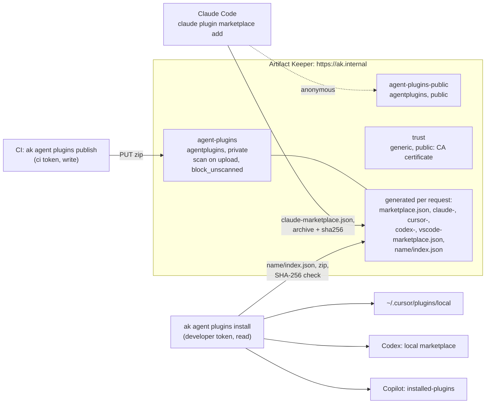

---
tags:
  - agent plugins
  - Claude Code
  - Cursor
  - Codex
  - GitHub Copilot
  - MCP
  - skills
  - TLS
  - tokens
  - scanning
  - immutability
description: >-
  A private marketplace of AI coding-agent plugins on Artifact Keeper: publish once, install in
  Claude Code from the registry's own marketplace, and in Cursor, Codex and Copilot with the ak
  CLI, with immutable versions, scoped tokens, scanning and an audit trail.
---

# A private marketplace for AI coding-agent plugins

This walkthrough builds one governed place for the plugins your developers load into their AI
coding agents. A platform team publishes internal plugins (review skills, coding standards, an
MCP server, release tooling) to an Artifact Keeper repository of the new `agentplugins` format.
Claude Code installs them straight from the registry's marketplace over TLS. Cursor, Codex and
GitHub Copilot get the same bytes through the `ak` CLI. The registry makes every version
immutable, lets only scoped tokens read or publish, scans each upload before it is served, and
records who published and who installed what. The last step proves the failure modes are
closed: overwrites, ambiguous bundles, tampered downloads, unscanned versions and leaked tokens.

Everything runs in containers on one host. The code is in
[`private-agent-plugin-marketplace/`](https://github.com/artifact-keeper/walkthroughs/tree/main/private-agent-plugin-marketplace),
and `make all` followed by `make gates` reproduces the whole thing from an empty registry.
No Anthropic, OpenAI, GitHub or Cursor account is needed for any of it except the few checks
that run a model session, which the gates report as blocked rather than failed.

!!! note "Registry version"
    The `agentplugins` format first ships in Artifact Keeper **1.12.0**. Until that release is
    published, the walkthrough runs the first `main` build that carries it,
    `ghcr.io/artifact-keeper/artifact-keeper-backend:sha-c3a650e`
    ([artifact-keeper#5256](https://github.com/artifact-keeper/artifact-keeper/pull/5256),
    tracking issue [#5251](https://github.com/artifact-keeper/artifact-keeper/issues/5251)),
    with the web UI `:dev` build that has the Agent Plugins setup tab. The `ak agent plugins`
    command first ships in the CLI prerelease **v1.11.0-rc.2**; the client image downloads that
    release's binary and checks its SHA-256 and cosign signature (`AK_CLI_RELEASE=source` builds
    [artifact-keeper-cli@10eafa8](https://github.com/artifact-keeper/artifact-keeper-cli/commit/10eafa8)
    from source instead). When the releases are out, change `BACKEND_IMAGE` in `registry/.env`
    to `1.12.0` and `AK_CLI_RELEASE` in `client/VERSIONS`.

## Who this is for

Platform and security teams in organizations where developers already use Claude Code, Cursor,
Codex or Copilot, and where internal plugins have started to spread as git repositories,
copied folders and links in chat. A plugin is code that runs inside the agent: hooks run
commands, MCP servers start processes, skills steer what the agent does. The questions are the
ones you already ask of packages. Who published this version, and can it change after review?
Who can read it? Was it scanned? Which machines installed it? The requirements below come from
those questions.

## What you will be able to show

| | Requirement | Where |
|---|---|---|
| R1 | One private registry over TLS with a bare hostname; every client trusts the internal CA | [Step 1](1-stand-up-the-registry.md) |
| R2 | Plugins authored once, in the layouts the agents read: Claude Code, the Agent Plugins Standard, multi-harness | [Step 2](2-author-the-plugins.md) |
| R3 | Publishing needs a write token for one repository; reading needs a token; a read token cannot publish | [Step 1](1-stand-up-the-registry.md), [Step 8](8-prove-it-fails-safely.md) |
| R4 | Publish rules close the ambiguous cases: no overwrite, no manifest, mismatched name or version, build metadata, unsafe entries, bad names | [Step 3](3-publish.md), [Step 8](8-prove-it-fails-safely.md) |
| R5 | Claude Code installs from the registry with nothing else installed, for a private and a public repository | [Step 4](4-install-in-claude-code.md) |
| R6 | Cursor, Codex and Copilot get the same verified bytes through `ak` | [Step 5](5-install-in-cursor-codex-copilot.md) |
| R7 | Updates reach Claude Code and the `ak` installs; the CLI says what is behind | [Step 6](6-ship-an-update.md) |
| R8 | The marketplace documents are a stable contract: naming, `archive` sources with a correct `sha256`, per-agent membership, caching | [Step 3](3-publish.md), [Step 8](8-prove-it-fails-safely.md) |
| R9 | Versions stay immutable across a delete; a tampered download is refused by the client | [Step 8](8-prove-it-fails-safely.md) |
| R10 | Nothing unscanned is served | [Step 7](7-govern.md) |
| R11 | An audit trail of publishes and installs | [Step 7](7-govern.md) |
| R12 | Tokens stay out of logs, and the one place they cannot is stated | [Step 4](4-install-in-claude-code.md), [Step 8](8-prove-it-fails-safely.md) |

## The shape of it



Three internal plugins stand in for yours: `acme-review` (Claude Code layout: a skill, a
command, an agent and a hook), `acme-standards` (the Agent Plugins Standard layout: skills and
an MCP server) and `acme-release-notes` (one skill with manifests for Claude Code, Cursor and
Codex). The developer workstation is a container with Claude Code, Codex, the Copilot CLI, the
Cursor CLI and `ak`, each run with a throwaway home.

## Before you start

- A Linux host with rootless podman 5.x and `podman compose` (or docker-compose), curl, jq,
  openssl, python3, unzip and GNU make. No sudo is needed anywhere.
- About 6 GB of free RAM for the registry stack and 8 GB of disk for images.
- Internet access for the first run: container images from ghcr.io and docker.io, the agent
  CLIs from npmjs.com, the `ak` source from GitHub, and the scanner's vulnerability database.
- Loopback port `127.0.0.1:30447` free (change `HTTPS_PORT` in `registry/.env` otherwise).

!!! tip "Run it yourself"
    ```bash
    git clone https://github.com/artifact-keeper/walkthroughs
    cd walkthroughs/private-agent-plugin-marketplace
    make all           # registry, plugins, publish, Claude Code, ak installs, update, scan, audit
    make gates         # the ten gates, including every refusal
    make screens-ready # the UI address and where the admin password is
    ```
    TIMING_PLACEHOLDER

## Steps

1. [Stand up the registry](1-stand-up-the-registry.md): TLS, a bare hostname, three repositories, a scan policy, scoped tokens.
2. [Author the plugins](2-author-the-plugins.md): three layouts, one validator.
3. [Publish](3-publish.md): `ak agent plugins publish`, a plain `curl -T`, and the documents the registry generates.
4. [Install in Claude Code](4-install-in-claude-code.md): the settings route, the token-in-path route, a public repository.
5. [Install in Cursor, Codex and Copilot](5-install-in-cursor-codex-copilot.md): `ak agent plugins install` and what each agent sees.
6. [Ship an update](6-ship-an-update.md): a new version through Claude Code and `ak`.
7. [Govern: scanning, tokens and audit](7-govern.md): the scan hold, who can do what, who installed what.
8. [Prove it fails safely](8-prove-it-fails-safely.md): the ten gates.

Then [Results](results.md) and [Next steps](next-steps.md). The [lab notes](findings.md) are the
unedited record every page is written from, and the [plan](plan.md) is the design we started
with.
