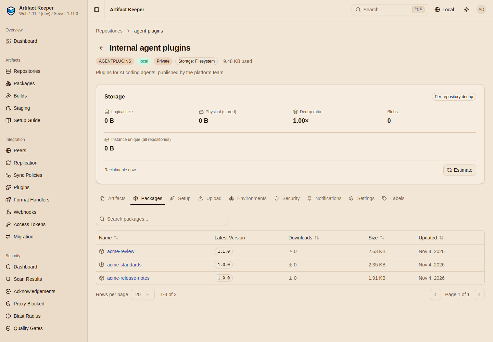

# Results

Two runs on `grace` (Ubuntu 26.04, 40 cores, rootless podman 5.7) on 2026-11-04, each from an
empty registry: `make all`, then `make gates`; between them `make clean`. Backend
`artifact-keeper-backend:sha-c3a650e`, web `:dev` (895d28d), ak `v1.11.0-rc.2` (release
binary, SHA-256 and cosign signature verified), Claude Code 2.1.318, Codex 0.166.0, Copilot
CLI 1.0.105, Cursor CLI 2026.10.22. Container images for the stack were already in the host's
image store, so the times do not include pulling them.

## The gates

Both runs gave the same verdicts: **96 PASS, 0 FAIL, 3 BLOCKED** of 99 checks.

| Gate | Checks | Result | Time (run 2) |
|---|---|---|---|
| G1 Auth | anonymous 401 on the private repository; read token 200 and 403 on publish; anonymous publish 401; tokens for another repository refused; bogus path token 401; path token 200; public repository 200 without credentials; no credential in 62 committed files | 12 PASS | 1 s |
| G2 Publish rules | 201, then 409 for the same and for different bytes; 400 for no manifest, name mismatch, version mismatch, `1.0.0+build`, `1.0`, uppercase slug, `../` entry, symbolic link, wrong file name, wrong checksum; none of them in any document | 15 PASS | 2 s |
| G3 Index contract | Claude Code naming rules, `owner.name`, no `$schema`, `archive` sources, version equals path, `sha256` equals the bytes; ETag and 304; `no-cache`; token route `private, no-store`, `Referrer-Policy: no-referrer` on the wire, prefix kept on archive URLs; membership and latest of all five documents; `index.json` order | 18 PASS, 1 BLOCKED(F1) | 3 s |
| G4 Claude Code | settings marketplace registered by a session start; install; listed at the latest version; skill, command, agent, hook in the cache; cache byte-identical to the zip; manifest version; Standard plugin with skills; `details` | 8 PASS, 1 BLOCKED(account) | 6 s |
| G5 Tampering | mirror serves other bytes under the genuine `sha256`; `ak` refuses and installs nothing; control install succeeds; Claude Code refuses and caches nothing | 4 PASS | 4 s |
| G6 Immutability | delete; documents fall back; `index.json` and download follow; different bytes 409; identical bytes 201 and the original bytes served | 8 PASS | 1 s |
| G7 Scan gate | policy; unscanned 403 and no `index.json`; listed after its scan; unscanned 1.1.0 hidden and 403 while 1.0.0 stays listed; 1.1.0 listed and 200 after its scan | 7 PASS | 1 s |
| G8 ak harnesses | four harness directories and `plugin-info.json`; Claude Code and Codex local marketplaces; Claude Code, Codex and Copilot list it; behind, current, ahead; uninstall | 11 PASS, 1 BLOCKED(account) | 15 s |
| G9 Generic upload | accepted, but not in `index.json`, not downloadable, no `index.json` for a side-loaded name, not in `marketplace.json` | 6 PASS | 1 s |
| G10 Token hygiene | token absent from the Caddy and backend logs, `REDACTED` in its place for both URL shapes and for the header; where Claude Code stores it on each route | 7 PASS | 3 s |

The three blocked checks:

- **BLOCKED(F1), G3: the backend itself sends `Referrer-Policy: no-referrer` on the token
  route.** It sends `strict-origin-when-cross-origin`, because Artifact Keeper's global
  security-headers middleware overwrites the header the token router sets. Clients of this
  deployment get `no-referrer`, which Caddy restores; the backend needs the fix
  ([lab notes](findings.md#f1-referrer-policy-overwritten-on-the-token-route)).
- **BLOCKED(account), G4: a signed-in Claude Code session uses the plugin.** Needs an
  Anthropic login; the gate prints the commands to run after `/login`.
- **BLOCKED(account), G8: the agents use the installed plugin in a session.** Needs Codex,
  Copilot and Cursor logins (or a Cursor window reload).

## Timings

| Step | Run 1 | Run 2 |
|---|---|---|
| `make clean` | | 5 s |
| `make all` | 232 s | 219 s |
| `make gates` | 36 s | 37 s |

Inside `make all` (run 2):

| Target | Time | Notes |
|---|---|---|
| `registry-up` | 31 s | images cached |
| `bootstrap` | 5 s | |
| `client` | 151 s | npm installs and the Cursor installer; the `ak` stage is kept by `make clean`. In run 1 the `ak` stage was built too (release download, checksum, cosign); `AK_CLI_RELEASE=source` makes it a cargo build of about 12 minutes |
| `validate` | 2 s | |
| `publish` | 6 s | including the scans: Grype finishes about 5 s after each upload |
| `indexes` | 2 s | |
| `consume-claude` | 7 s | three homes, four installs |
| `consume-cli` | 8 s | seven installs across three agents |
| `update` | 5 s | |
| `scan` | 2 s | |
| `audit` | under 1 s | |

## What this shows

- Claude Code installs from a private Artifact Keeper repository over TLS with nothing else on
  the machine and no Anthropic account, by either the settings route or the token-in-path
  route, and from a public repository with no credentials.
- Cursor, Codex and Copilot get the same verified bytes through `ak agent plugins install`, and
  their own CLIs see them without an account.
- Every refusal the design promises happens: overwrites, ambiguous bundles, tampered downloads,
  unscanned versions, side-loaded files, cross-repository tokens.
- Tokens stay out of both logs. On the client, the token-in-path route leaves the token in three
  files; the settings route keeps it out of every URL.

## What it found

- **F1**: the token route's `Referrer-Policy: no-referrer` is overwritten by the backend's
  global security-headers layer (worked around in Caddy).
- An Agent Plugins publish writes no audit event; the publisher is on the artifact record.
- Claude Code registers settings-declared marketplaces only when a session starts.
- The token-in-path route stores the token in `settings.json`, `known_marketplaces.json` and the
  cached marketplace; the upstream docs name only `known_marketplaces.json`.
- `ak` sends no `User-Agent`, so its downloads are not identifiable in the download records.
- The web UI's Packages tab shows 0 downloads for versions with download records.

Details for each are in the [lab notes](findings.md).

