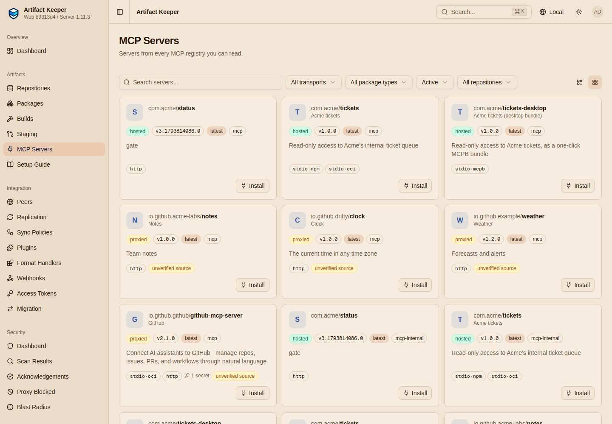
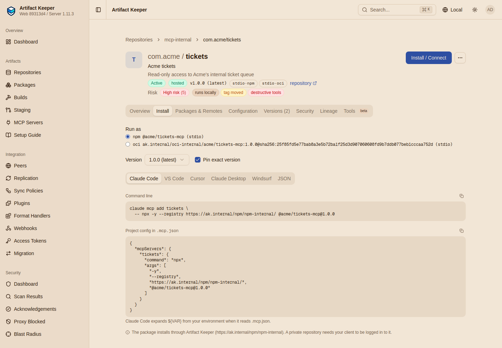

# Step 2: A private registry for internal servers

--8<-- "includes/preview-mcp.md"

Acme's platform team has an MCP server, `com.acme/tickets`: a small stdio server with two
read-only tools, `list_tickets` and `get_ticket`
([`servers/acme-tickets/`](https://github.com/artifact-keeper/walkthroughs/tree/main/private-mcp-registry/servers/acme-tickets)).
It ships two ways, as an npm package and as a container image. This step publishes both and
the registry entry that describes them, then points clients at the registry.

```bash
make publish   # npm package, image, /validate, mcp-publisher publish
make clients   # what VS Code and Copilot read; Claude Code; a real tool call
```

## Publish the packages first

Under the `own-repos` package policy, a server is accepted only when the packages it runs are
already in this Artifact Keeper. So a publishing job has three parts, in this order
([`flows/publish.sh`](https://github.com/artifact-keeper/walkthroughs/blob/main/private-mcp-registry/flows/publish.sh)),
all with the `ci` token.

**The npm package** goes to `npm-internal` with a plain `npm publish`:

```console
$ npm publish --registry https://ak.internal/npm/npm-internal/
npm notice package: @acme/tickets-mcp@1.0.0
npm notice total files: 2
npm notice Publishing to https://ak.internal/npm/npm-internal/ with tag latest and default access
+ @acme/tickets-mcp@1.0.0
```

npm finds the token by the registry's exact path, so `~/.npmrc` has one line per repository:
`//ak.internal/npm/npm-internal/:_authToken=${AK_TOKEN}`.

**The image** is built from
[`servers/acme-tickets/Containerfile`](https://github.com/artifact-keeper/walkthroughs/blob/main/private-mcp-registry/servers/acme-tickets/Containerfile),
which labels it with the server's name (`io.modelcontextprotocol.server.name=com.acme/tickets`).
It is built on the host with podman, saved as an archive, and copied to the registry by skopeo
(a tool that copies images between registries) inside the workstation, so it reaches the
registry by its real name:

```console
$ skopeo copy --dest-creds ci:$AK_TOKEN oci-archive:/out/images/tickets-mcp-1.0.0.tar \
    docker://ak.internal/oci-internal/acme/tickets-mcp:1.0.0
$ skopeo inspect ... docker://ak.internal/oci-internal/acme/tickets-mcp:1.0.0
{"Digest":"sha256:25f85fd5e77bab8a3e5b72ba1f25d3d907060608fd9b7ddb077beb1cccaa752d","label":"com.acme/tickets"}
```

## Validate, then publish the entry

[`servers/acme-tickets/server.json`](https://github.com/artifact-keeper/walkthroughs/blob/main/private-mcp-registry/servers/acme-tickets/server.json)
is the registry entry (schema `2025-12-11`). Abridged:

```json title="servers/acme-tickets/server.json (abridged)"
{
  "name": "com.acme/tickets",
  "version": "1.0.0",
  "packages": [
    {"registryType": "npm", "identifier": "@acme/tickets-mcp", "version": "1.0.0",
     "runtimeHint": "npx", "transport": {"type": "stdio"}},
    {"registryType": "oci", "identifier": "ak.internal/oci-internal/acme/tickets-mcp:1.0.0",
     "runtimeHint": "docker", "transport": {"type": "stdio"}}
  ],
  "_meta": {"io.modelcontextprotocol.registry/publisher-provided": {
    "com.artifactkeeper/capabilities": {"tools": [{"name": "list_tickets", ...}, {"name": "get_ticket", ...}]}}}
}
```

The npm entry has no `registryBaseUrl`: the registry fills it in. The image names a tag; the
registry pins the digest. The `_meta` block declares the tools, which the registry records and
lints ([Step 4](4-supply-chain-gates.md), [Step 7](7-bundles-and-capabilities.md)).

`POST /validate` is a dry run of a publish. It tells you what would happen to each package:

```console
$ curl -X POST -H "Authorization: Bearer $AK_TOKEN" --data-binary @server.json \
    https://ak.internal/mcp/mcp-internal/v0.1/validate
HTTP 200
{"issues":[],"packages":[{"index":0,"outcome":"pinned","registryType":"npm"},{"index":1,"outcome":"pinned","registryType":"oci"}],"valid":true}
```

`pinned` for both. Had a package been missing, the answer would say so, and the script stops:
a CI job should publish only when every package is `pinned`
([lab notes, O1](findings.md#o1-a-virtual-npm-mapping-fills-missing-internal-packages-from-upstream)).
On a private registry `/validate` needs a token, so `mcp-publisher validate` (which sends none)
gets `401`; call it with curl.

`mcp-publisher` is the official registry's CLI. It reads the registry URL and token from
`~/.config/mcp-publisher/token.json`. Instead of `mcp-publisher login`, which only knows the
official registry's login methods, write the file with an Artifact Keeper token:

```console
$ jq -n --arg t "$AK_TOKEN" '{token: $t, method: "none", registry: "https://ak.internal/mcp/mcp-internal"}' \
    > ~/.config/mcp-publisher/token.json
$ cd servers/acme-tickets && mcp-publisher publish
Publishing com.acme/tickets@1.0.0 to https://ak.internal/mcp/mcp-internal...
✓ Successfully published
✓ Server com.acme/tickets version 1.0.0
```

## What the registry serves

Read back with the developer's token, the entry carries Artifact Keeper's coordinates: the npm
package's `registryBaseUrl` is `npm-internal`, and the image is pinned to the digest it had at
publish time.

```json
{
  "name": "com.acme/tickets",
  "version": "1.0.0",
  "packages": [
    {"registryType": "npm", "identifier": "@acme/tickets-mcp", "version": "1.0.0",
     "registryBaseUrl": "https://ak.internal/npm/npm-internal"},
    {"registryType": "oci",
     "identifier": "ak.internal/oci-internal/acme/tickets-mcp:1.0.0@sha256:25f85fd5e77bab8a3e5b72ba1f25d3d907060608fd9b7ddb077beb1cccaa752d"}
  ],
  "source": {"repository": "mcp-internal", "origin": "hosted", "packagePolicy": "own-repos"}
}
```

A client that follows these coordinates installs exactly what was reviewed, from the registry.

## Point the clients at it

[`flows/clients.sh`](https://github.com/artifact-keeper/walkthroughs/blob/main/private-mcp-registry/flows/clients.sh)
does what each client does, as far as it can be scripted. It also writes the client settings to
`out/clients/`.

### VS Code (not machine-verified)

VS Code's MCP gallery reads a registry URL from one setting (or the `McpGalleryServiceUrl`
policy on managed machines):

```json title="settings.json"
{ "chat.mcp.gallery.serviceUrl": "https://ak.internal/mcp/mcp-internal" }
```

The gallery lists `GET /v0.1/servers` and, when you pick a server, reads
`/versions/latest`. Both answered as VS Code expects:

```console
$ GET /mcp/mcp-internal/v0.1/servers
{"name":"com.acme/tickets","version":"1.0.0","isLatest":true}
$ GET /mcp/mcp-internal/v0.1/servers/com.acme%2Ftickets/versions/latest
{"registryType":"npm","identifier":"@acme/tickets-mcp","version":"1.0.0","registryBaseUrl":"https://ak.internal/npm/npm-internal"}
{"registryType":"oci","identifier":"ak.internal/oci-internal/acme/tickets-mcp:1.0.0@sha256:25f85fd5...","version":null,"registryBaseUrl":null}
```

The gallery install itself needs a person in VS Code; gate G4 reports it as
`BLOCKED(gui)` with these steps. VS Code must trust the internal CA and send a token the
registry accepts; for a private registry, check how your VS Code version authenticates to a
custom gallery before you roll it out.

### GitHub Copilot (not machine-verified)

In the organization's Copilot policies, set the MCP registry URL to
`https://ak.internal/mcp/mcp-internal` (or the Virtual of [Step 6](6-one-url-for-clients.md))
and the access to "Registry only". Copilot appends `/v0.1/servers` and checks CORS before it
accepts the URL. The preflight answers:

```text
HTTP/2 200
access-control-allow-headers: authorization,content-type
access-control-allow-methods: GET,OPTIONS
access-control-allow-origin: *
```

Copilot must be able to reach the URL, so in practice this needs a name reachable from where
Copilot evaluates the policy. That and the policy itself are not machine-verified (G4).

### Claude Code (run)

Claude Code has no registry subscription; you add a server with the command its registry entry
describes. The script derives that command from the served entry: `npx`, the npm package at its
version, and `registryBaseUrl` as the npm registry. `claude mcp list` then starts the server
and checks that it answers, with no Anthropic account:

```console
$ claude mcp add acme-tickets --scope user -- npx -y --registry https://ak.internal/npm/npm-internal/ @acme/tickets-mcp@1.0.0
Added stdio MCP server acme-tickets with command: npx -y --registry https://ak.internal/npm/npm-internal/ @acme/tickets-mcp@1.0.0 to user config
$ claude mcp list
Checking MCP server health…

acme-tickets: npx -y --registry https://ak.internal/npm/npm-internal/ @acme/tickets-mcp@1.0.0 - ✔ Connected
```

Using the tools in a session needs a login and is not run here. Instead, `mcp-call` (a
60-line MCP client in the workstation,
[`client/mcp-call.js`](https://github.com/artifact-keeper/walkthroughs/blob/main/private-mcp-registry/client/mcp-call.js))
starts the same command and calls a tool:

```console
$ mcp-call list_tickets '{"status":"open"}' -- npx -y --registry https://ak.internal/npm/npm-internal/ @acme/tickets-mcp@1.0.0
{"serverInfo":{"name":"acme-tickets","version":"1.0.0"},"tools":["list_tickets","get_ticket"],
 "call":{"content":[{"type":"text","text":"[{\"id\":101,\"status\":\"open\",\"title\":\"Rotate the CI publishing token\"},{\"id\":102,\"status\":\"open\",\"title\":\"Review held MCP server versions\"}]"}],"isError":false}}
```

### The web UI

The web UI (artifact-keeper-web#1077) has an MCP Servers gallery and a server page whose
Install tab writes the same command for Claude Code, VS Code, Cursor and others:





Next: [Step 3, curate the public registry](3-curate-the-public-registry.md).
