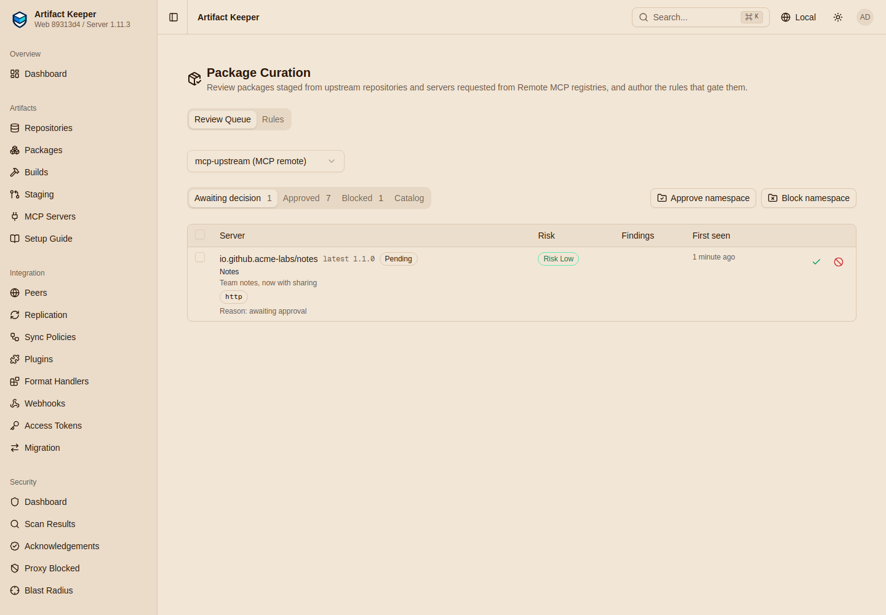

# Step 3: Curate the public registry

--8<-- "includes/preview-mcp.md"

Developers will want servers from the public MCP registry. A Remote `mcp` repository gives
them a curated copy: **an allowlist that happens to be populated from upstream, not a mirror
of it.** Nothing from upstream is served until someone approves it.

```bash
make curate
```

[`flows/curate.sh`](https://github.com/artifact-keeper/walkthroughs/blob/main/private-mcp-registry/flows/curate.sh)
runs every call on this page.

## The upstream: a lab registry

The upstream is the lab registry from [Step 1](1-stand-up-the-registry.md), not
`registry.modelcontextprotocol.io`, for two reasons: its entries are the same on every run,
and it has the cases worth showing, which the public registry may not have on a given day.
Its ten entries
([`lab-registry/servers/`](https://github.com/artifact-keeper/walkthroughs/tree/main/private-mcp-registry/lab-registry/servers)):

| Server | Packaging | Here to show |
|---|---|---|
| `io.github.modelcontextprotocol/server-everything` 2.1.0, `server-memory` 2.0.1 | npm (the real packages) | auto-approval by glob |
| `io.github.example/weather` 1.2.0 | remote | a developer's request, approved |
| `io.github.examp1e/weather` 1.2.0 | remote | a lookalike name |
| `io.github.evil-corp/exfil` 0.1.0 | remote | the deny list |
| `io.github.acme-labs/notes` 1.0.0, 1.1.0 | remote | a pinned version |
| `io.github.drifty/clock` 1.0.0 | remote | content changing under a version |
| `io.github.github/github-mcp-server` 2.1.0 | OCI on ghcr.io (copied from the public registry) | an image pinned through a Remote |
| `com.acme/tickets` 9.9.9 | remote | someone upstream using Acme's name ([Step 6](6-one-url-for-clients.md)) |

To use the public registry, set `upstream_url` to `https://registry.modelcontextprotocol.io`.
It had about 40,000 server versions on 2026-11-04; nothing else on this page changes.

## The Remote

```json
{"key": "mcp-upstream", "format": "mcp", "repo_type": "remote", "visibility": "private",
 "upstream_url": "http://172.31.76.200:8080",
 "mcp_package_repos": {"npm": "npm-remote", "oci": "oci-ghcr"},
 "mcp_auto_approve_namespaces": ["io.github.modelcontextprotocol/*"],
 "mcp_server_deny": ["io.github.evil-corp/*"]}
```

The defaults it echoes back are the ones you want: `mcp_remote_posture: approval_required`
(deny by default) and `mcp_remote_mode: allowlist` (store only what is approved). Packages of
upstream servers are pinned like hosted ones, through the Remote's own `mcp_package_repos`:
`npm-remote` for npm, and `oci-ghcr`, a new docker Remote of ghcr.io, for images. The two globs
match the **full** name: `io.github.modelcontextprotocol/*`, not a bare namespace.

Before the first sync, a developer asking for a server that exists upstream gets the same
answer as for a name that exists nowhere:

```console
$ GET /mcp/mcp-upstream/v0.1/servers/io.github.example%2Fweather/versions/latest
HTTP 404
{"detail":"Server not found","status":404,"title":"Not Found","type":"about:blank"}
```

That `404` is deliberate. VS Code treats a `404` on `/versions/latest` as "not in the
registry", and under Copilot's "Registry only" policy that disables the server; any other
error is treated as temporary.

## Sync and the approval queue

A sync (hourly, or on demand) reads upstream's `/v0.1/servers`, records every name in the
catalog, approves names that match the auto-approve globs, and flags lookalikes:

```console
$ POST /api/v1/repositories/mcp-upstream/mcp/sync
{"pages":1,"entries":10,"namesNew":9,"autoApproved":2,"flagged":2,"ingested":2,"unchanged":0,
 "statusChanged":0,"drifted":0,"invalid":0,"unresolved":2,"reResolved":0,"backfilledNames":0,"complete":true,"errors":[]}
$ GET /api/v1/repositories/mcp-upstream/mcp/catalog
{"review":2,"approved":2,"pending":5}
{"name":"com.acme/tickets","status":"pending","flags":{},"denied":false,"ingested":[]}
{"name":"io.github.acme-labs/notes","status":"pending","flags":{},"denied":false,"ingested":[]}
{"name":"io.github.drifty/clock","status":"pending","flags":{},"denied":false,"ingested":[]}
{"name":"io.github.evil-corp/exfil","status":"pending","flags":{},"denied":true,"ingested":[]}
{"name":"io.github.examp1e/weather","status":"review","flags":{"typosquat":{"similarTo":"io.github.example/weather"}},"denied":false,"ingested":[]}
{"name":"io.github.example/weather","status":"review","flags":{"typosquat":{"similarTo":"io.github.examp1e/weather"}},"denied":false,"ingested":[]}
{"name":"io.github.github/github-mcp-server","status":"pending","flags":{},"denied":false,"ingested":[]}
{"name":"io.github.modelcontextprotocol/server-everything","status":"approved","flags":{},"denied":false,"ingested":[{"version":"2.1.0","unresolved":["mcp_package_not_found"]}]}
{"name":"io.github.modelcontextprotocol/server-memory","status":"approved","flags":{},"denied":false,"ingested":[{"version":"2.0.1","unresolved":["mcp_package_not_found"]}]}
```

- The two `io.github.modelcontextprotocol/*` names were approved by the glob and ingested,
  but their npm packages are not in `npm-remote` yet (below).
- **Lookalikes go to `review`, both of them.** `io.github.examp1e` is one edit from
  `io.github.example` (and the same after folding `1` and `l`). The sync cannot know which one
  is genuine, so it flags both and auto-approves neither.
- The denied name is marked `denied` before anyone looks at it.

A developer can ask for a server, but not approve it:

```console
$ POST .../catalog/<id of io.github.example/weather>/request-approval {"note":"Forecasts for the field-ops agents"}
{"name":"io.github.example/weather","status":"review","approvalRequests":{"count":1},"flags":{"typosquat":{"similarTo":"io.github.examp1e/weather"}}}
$ POST .../catalog/<id>/approve      (developer token)
HTTP 403
{"code":"FORBIDDEN","message":"Token does not have required scope: write:repositories"}
```

## Decisions

The curator (the admin here; any repository administrator) approves the real server and
blocks the lookalike:

```console
{"name":"io.github.example/weather","status":"approved","ingestError":null}
{"name":"io.github.examp1e/weather","status":"blocked"}
```

**Deny wins.** A bulk approval of the denied namespace approves nothing, a bare namespace is
refused because it would match no full name, and even a direct approval does not make a denied
server visible:

```console
$ POST .../catalog/bulk-approve {"pattern":"io.github.evil-corp/*","dryRun":true}
{"approved":0,"blocked":0,"names":[],"skippedDenied":1,"skippedReview":0,"dryRun":true}
$ POST .../catalog/bulk-approve {"pattern":"io.github.evil-corp"}
HTTP 422
{"code":"UNPROCESSABLE_ENTITY","message":"pattern: `io.github.evil-corp` matches no server name (patterns match the full name `namespace/name`); use `io.github.evil-corp/*` for every server in the namespace"}
$ POST .../catalog/<id of io.github.evil-corp/exfil>/approve
{"name":"io.github.evil-corp/exfil","status":"approved","denied":true}
$ GET /mcp/mcp-upstream/v0.1/servers/io.github.evil-corp%2Fexfil/versions/latest
HTTP 404
```

**Pin a version.** `io.github.acme-labs/notes` 1.1.0 adds sharing, which nobody has reviewed.
Pinning `1.0.0` serves that version only, and the name stays `pending`:

```console
$ POST .../catalog/pins {"name":"io.github.acme-labs/notes","version":"1.0.0","reason":"1.1.0 adds sharing; not reviewed"}
{"name":"io.github.acme-labs/notes","status":"pending","pins":[{"version":"1.0.0","status":"approved"}]}
$ GET /mcp/mcp-upstream/v0.1/servers/io.github.acme-labs%2Fnotes/versions
["1.0.0"]
$ GET .../io.github.acme-labs%2Fnotes/versions/1.1.0
HTTP 404
```

The web UI shows the same queue on the Curation page:



## Upstream packages are pinned too

An approved upstream server is served only when its packages are pinned in your registry,
through the Remote's `mcp_package_repos`. For an image that works: pull it through `oci-ghcr`
once, approve the name, and the served entry names Artifact Keeper and the digest:

```console
$ skopeo inspect docker://ak.internal/oci-ghcr/github/github-mcp-server:2.1.0
{"Digest":"sha256:f6056fc10bfffcc8c81a6417a2e9ca12808647e8dd6049642a4feaadee0e0f8a"}
$ POST .../catalog/<id of io.github.github/github-mcp-server>/approve
{"name":"io.github.github/github-mcp-server","status":"approved","ingested":[{"version":"2.1.0","unresolved":[]}]}
$ GET /mcp/mcp-upstream/v0.1/servers/io.github.github%2Fgithub-mcp-server/versions/latest
{"version":"2.1.0","oci":["ak.internal/oci-ghcr/github/github-mcp-server:2.1.0@sha256:f6056fc10bfffcc8c81a6417a2e9ca12808647e8dd6049642a4feaadee0e0f8a"],
 "source":{"origin":"remote","upstreamUrl":"http://172.31.76.200:8080","upstreamVerified":false}}
```

For npm it does not work in this build. The refusal says to pull the package through
`npm-remote` first; after `npm pack` of both packages through it, the next sync re-resolves
nothing and both servers stay held:

```console
$ npm pack --registry https://ak.internal/npm/npm-remote/ @modelcontextprotocol/server-everything@2.1.0
modelcontextprotocol-server-everything-2.1.0.tgz
$ POST .../sync
{"entries":0,"ingested":0,"unresolved":0,"reResolved":0}
{"name":"io.github.modelcontextprotocol/server-everything","unresolved":["mcp_package_not_found"]}
```

This is an Artifact Keeper bug: the Remote sync looks for npm, PyPI, NuGet and Cargo packages
only among stored artifacts, not in a Remote's proxy cache where pulled packages live
([lab notes, F1](findings.md#f1-a-remote-never-pins-npm-packages-pulled-through-npm-remote)).
Gate G5 reports it as `BLOCKED(ak-fix)`.

## When upstream changes a version

A version, once ingested, is never overwritten. `io.github.drifty/clock` 1.0.0 is approved and
served. Then upstream changes the document under the same version, adding an instruction to
the model in the description and moving the URL. The next sync notices, holds the version and
puts it back in the queue:

```console
$ POST .../sync
{"entries":1,"drifted":1}
$ GET /mcp/mcp-upstream/v0.1/servers/io.github.drifty%2Fclock/versions/1.0.0     (developer)
HTTP 404
{"detail":"This server version changed upstream and is awaiting re-approval","error":"mcp_pending_review",
 "gate":"curation","hold":"content_drift","name":"io.github.drifty/clock","version":"1.0.0",...}
$ GET .../catalog/servers/io.github.drifty/clock
{"status":"approved","pins":[{"version":"1.0.0","status":"review","contentDrift":{"detectedAt":"2026-11-04T17:40:32.545737870Z",
 "storedSha256":"6f4a7bb8...","upstreamSha256":"311b5171..."}}]}
```

The developer sees the reason because, in a private registry, anyone with a `read` grant is a
"holder" of the repository; a client only acts on the `404`
([lab notes, O2](findings.md#o2-in-a-private-registry-every-reader-sees-why-a-version-is-held)).
Re-approving serves the **stored** document, not the new upstream bytes:

```console
{"description":"The current time in any time zone","url":"https://clock.drifty.example/mcp"}
```

## What clients see now, and the audit trail

```console
$ GET /mcp/mcp-upstream/v0.1/servers
["io.github.acme-labs/notes@1.0.0","io.github.drifty/clock@1.0.0","io.github.example/weather@1.2.0","io.github.github/github-mcp-server@2.1.0"]
$ GET /mcp/mcp-upstream/v0.1/x/com.artifactkeeper/holds     (curator)
{"name":"io.github.modelcontextprotocol/server-everything","version":"2.1.0","hold":"unresolvable","error":"mcp_unresolvable"}
{"name":"io.github.modelcontextprotocol/server-memory","version":"2.0.1","hold":"unresolvable","error":"mcp_unresolvable"}
$ GET /api/v1/mcp/pending-summary
{"pending":2,"review":0,"drifted":0,"total":2,"repositories":[{"key":"mcp-upstream","pending":2,"review":0,"drifted":0}]}
```

Every decision is audited with its reason (abridged):

```text
MCP_SERVER_APPROVED      io.github.drifty/clock 1.0.0   "re-approved the stored 1.0.0; the upstream edit adds an injection phrase"
MCP_SERVER_REOPENED      io.github.drifty/clock 1.0.0   content_drift
MCP_SERVER_CONTENT_DRIFT io.github.drifty/clock 1.0.0   stored 6f4a7bb8... upstream 311b5171...
MCP_SERVER_APPROVED      io.github.acme-labs/notes 1.0.0 "1.1.0 adds sharing; not reviewed"
MCP_SERVER_REJECTED      io.github.examp1e/weather      "lookalike of io.github.example/weather"
MCP_SERVER_APPROVED      io.github.modelcontextprotocol/server-memory  auto_approve_namespace
MCP_MIRROR_SYNCED        {"entries":10,"namesNew":9,"autoApproved":2,"flagged":2,...}
```

Next: [Step 4, supply-chain gates](4-supply-chain-gates.md).
