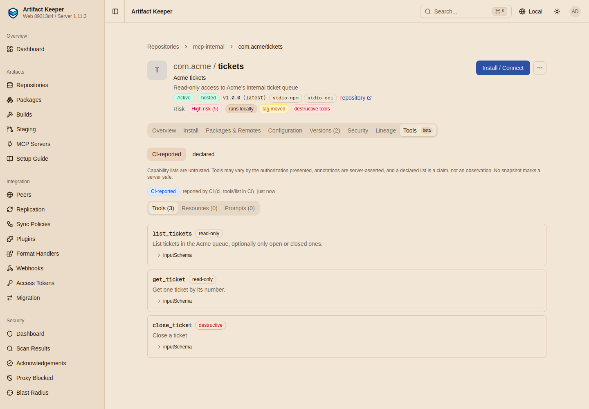

# Step 7: Bundles and capabilities

--8<-- "includes/preview-mcp.md"

Two more things a registry can know about a server: the bundle a desktop client installs with
one click, and the tools the server offers.

```bash
make bundles
```

[`flows/bundles.sh`](https://github.com/artifact-keeper/walkthroughs/blob/main/private-mcp-registry/flows/bundles.sh)
runs every call on this page.

## Signed MCPB bundles

An MCPB bundle (`.mcpb`) is a zip with a `manifest.json` that packages one server, the format
Claude Desktop installs. The `mcpb` CLI packs and signs one; Artifact Keeper verifies the
signature when the bundle is uploaded. Trust is an operator allowlist of signing certificates,
not a certificate authority: `MCP_TRUSTED_BUNDLE_SIGNERS` holds their SHA-256 fingerprints.
`registry/up.sh` generated a lab signer and put its fingerprint there before the backend
started. This step turns the requirement on:

```console
$ PATCH /api/v1/repositories/mcp-internal {"mcp_require_bundle_signature":true}
{"mcp_require_bundle_signature":true}
```

The `mcpb` CLI comes from npm through the registry (`npx --registry https://ak.internal/npm/npm/
@anthropic-ai/mcpb@2.1.2`). It packs
[`servers/acme-tickets/bundle/manifest.json`](https://github.com/artifact-keeper/walkthroughs/blob/main/private-mcp-registry/servers/acme-tickets/bundle/manifest.json)
and the server into three bundles: unsigned, self-signed with a new certificate, and signed by
the trusted lab signer.

A bundle is uploaded beside a version **before** the version is published:

```console
-- upload unsigned.mcpb:
HTTP 422
{"detail":"this registry requires signed MCPB bundles (mcpb sign)","error":"mcp_bundle_unsigned",...}
-- upload self-signed.mcpb:
HTTP 422
{"detail":"this registry requires MCPB bundles signed by a trusted signer; this signer's certificate fingerprint is not on the instance's trusted signer list","error":"mcp_bundle_signer_untrusted",...}
-- upload acme-tickets.mcpb (signed by the trusted signer):
HTTP 201
{"file":"acme-tickets.mcpb","fileSha256":"941ed51faf158e08605a503e011435a16ec4846b8941f024c7feae4f12ac2c0b",
 "signature":{"state":"valid","signer":"Acme MCP bundle signing (lab)","fingerprint":"1d7044a9..."},
 "packageEntry":{"fileSha256":"941ed51f...","identifier":"https://ak.internal/mcp/mcp-internal/v0.1/servers/com.acme/tickets-desktop/versions/1.0.0/bundles/acme-tickets.mcpb",
   "registryType":"mcpb","transport":{"type":"stdio"}}}
```

A bundle changed after signing is refused too (gate G9). The publish of
`com.acme/tickets-desktop` 1.0.0 uses the `packageEntry` the upload returned as its
`packages[0]`. A server with no other package cannot leave `packages` out and rely on the
registry to add the entry
([lab notes, D2](findings.md#d2-a-bundle-only-server-cannot-rely-on-the-automatic-package-entry)).

## Download tickets

The registry is private, but a desktop client handed the document should not need a registry
token to fetch the bundle. An exact read by an authenticated caller adds a single-use ticket
(valid five minutes) to the bundle URL; a listing does not:

```console
$ GET /mcp/mcp-internal/v0.1/servers/com.acme%2Ftickets-desktop/versions/1.0.0     (developer)
https://ak.internal/mcp/mcp-internal/v0.1/servers/com.acme/tickets-desktop/versions/1.0.0/bundles/acme-tickets.mcpb?ticket=<redacted>
$ GET /mcp/mcp-internal/v0.1/servers?search=desktop
https://ak.internal/mcp/mcp-internal/v0.1/servers/com.acme/tickets-desktop/versions/1.0.0/bundles/acme-tickets.mcpb
-- download with the ticket and no credential:
HTTP/2 200
cache-control: private, no-store
x-checksum-sha256: 941ed51faf158e08605a503e011435a16ec4846b8941f024c7feae4f12ac2c0b
sha256 of the download: 941ed51faf158e08605a503e011435a16ec4846b8941f024c7feae4f12ac2c0b
-- the same ticket again: HTTP 401
```

A bundle is gated like any package: quarantine it, or hold its version, and the download is
the plain `404`.

## Capabilities: what tools a server offers

The registry keeps **capability snapshots** of each version (tools, resources, prompts) with
where each list came from. The bundle's manifest declared two tools:

```console
$ GET .../com.acme%2Ftickets-desktop/versions/1.0.0/capabilities
{"current":{"source":"publisher_declared","provenance":"declared in MCPB manifest","tools":["list_tickets","get_ticket"]},
 "notice":"Capability lists are untrusted. Tools may vary by the authorization presented, annotations are server-asserted, and a declared list is a claim, not an observation. No snapshot marks a server safe."}
```

A pipeline can report what the server actually answered. The script runs `tools/list` on the
installed `com.acme/tickets` 1.0.0 with `mcp-call` and posts it as `ci_reported`, then posts a
second report with one more tool, `close_ticket`, marked destructive, as a later build might:

```console
$ POST .../com.acme%2Ftickets/versions/1.0.0/capabilities {"source":"ci_reported","generatedBy":"tools/list in CI","tools":[...]}
{"source":"ci_reported","provenance":"reported by CI (ci, tools/list in CI)","tools":2,"drift":null}
$ POST ... (three tools)
{"source":"ci_reported","tools":3,"drift":{"scanId":"..."}}
$ GET .../capabilities/diff?source=ci_reported
{"summary":"Tools: +1 added (`close_ticket` now destructiveHint: true)","destructiveAdded":["close_ticket"]}
```

The change is a `tool_drift` finding (severity `medium` for a CI report, `high` for an
observed probe) on the server version's scan results, next to the lint, and a scan policy can
hold on it. The new tool also got a `destructive_tool` lint warning. The Tools tab shows the
current list with its provenance:



Artifact Keeper can also observe tool lists itself, by probing remote servers and running
stdio packages in a sandbox (the `ak-mcp-introspector` worker). That needs a gVisor or
microVM runtime and is not part of this walkthrough.

Next: [Step 8, prove it fails safely](8-prove-it-fails-safely.md).
