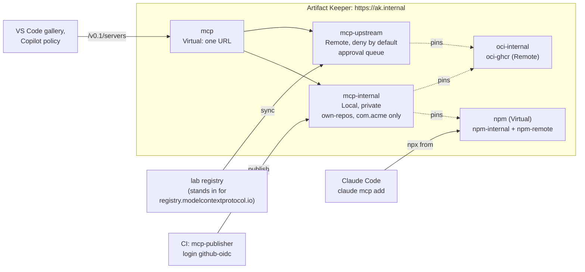

---
tags:
  - preview
  - MCP
  - Claude Code
  - VS Code
  - GitHub Copilot
  - npm
  - OCI
  - curation
  - typosquatting
  - CI/CD
  - OIDC
  - scanning
  - TLS
description: >-
  A private MCP registry on Artifact Keeper: publish internal MCP servers whose packages live in
  the same registry, curate the public MCP registry behind an approval queue, gate every server
  on its packages' quarantine, scan and lint verdicts, publish from CI with OIDC, and give every
  client one URL.
---

# A private MCP registry

--8<-- "includes/preview-mcp.md"

!!! warning "An example, not a complete defense"
    This walkthrough shows one way to run a private MCP registry on Artifact Keeper. The
    configuration is an example, built and tested in a lab. It does not cover every edge case
    or attack, and it is not a hardened production setup. In particular, the registry decides
    which servers a client is told about and pins the bytes they run; it does not prove that a
    server's code is benign, and a client that ignores the registry is not stopped by it. Some
    gaps we found are listed in [Findings](findings.md). Review and adapt it for your own
    environment, and use it alongside your other controls (code review of servers, sandboxing,
    client allowlists, secrets handling, monitoring), not instead of them.

An MCP server is code an AI agent starts on a developer's machine, with the developer's
credentials. The [MCP registry](https://registry.modelcontextprotocol.io) (a catalog of
servers, API v0.1) is how VS Code, GitHub Copilot and other clients find them. This
walkthrough puts Artifact Keeper's `mcp` repository type in that role for one organization:

- **A private registry for internal servers.** A platform team publishes `com.acme/tickets`
  with `mcp-publisher` (the official publishing CLI). Its npm package and container image live
  in Artifact Keeper too, so every coordinate a client is handed points back at the registry,
  pinned to a version and a digest.
- **A curated proxy of the public registry.** Upstream servers are deny by default. A sync
  fills an approval queue, a glob auto-approves trusted namespaces, a deny list wins over every
  approval, lookalike names are flagged, single versions can be pinned, and a version whose
  upstream bytes change is held until someone approves it again.
- **Supply-chain gates.** External packages are refused, a quarantined package or a
  scan-policy finding hides the server that runs it, and a lint refuses hardcoded secrets and
  holds tool descriptions that read like prompt injection.
- **Publishing from CI** with the job's OIDC token (`mcp-publisher login github-oidc`) and a
  grant limited to the job's own namespace.
- **One URL for clients:** a Virtual repository that merges the two, where an internal name can
  never be taken over from upstream.

Everything runs in containers on one host. The code is in
[`private-mcp-registry/`](https://github.com/artifact-keeper/walkthroughs/tree/main/private-mcp-registry),
and `make all` followed by `make gates` reproduces the whole thing from an empty registry. No
GitHub, Anthropic or Microsoft account is needed. The two GUI checks (VS Code's gallery and
Copilot's registry policy) cannot be scripted; the gates report them as blocked and say what
to do by hand, and check the exact requests those clients send instead.

## Who this is for

Platform and security teams whose developers already add MCP servers to Claude Code, VS Code,
Copilot or Cursor, from READMEs, chat messages and the public registry. The questions are the
ones you already ask of packages, plus a few that are new: which servers may run at all? Who
published this one, and can its package change under the same version? Is the server that a
developer installs the same code that was reviewed? What does the agent see in the tool
descriptions? The requirements below come from those questions.

## What you will be able to show

| | Requirement | Where |
|---|---|---|
| R1 | One private registry over TLS with a bare hostname; reading needs a token, publishing needs write | [Step 1](1-stand-up-the-registry.md) |
| R2 | Internal servers are published with the official tooling, and their packages live in the same registry | [Step 2](2-a-private-registry.md) |
| R3 | VS Code, Copilot and Claude Code use it; a client installs exactly the pinned package | [Step 2](2-a-private-registry.md) |
| R4 | Public servers are deny by default, approved by name, by glob or by pinned version; deny wins | [Step 3](3-curate-the-public-registry.md) |
| R5 | A server whose upstream document changes under the same version is held until re-approved | [Step 3](3-curate-the-public-registry.md) |
| R6 | Packages from outside the registry are refused; image tags are pinned to digests | [Step 4](4-supply-chain-gates.md) |
| R7 | A quarantined or flagged package, or a flagged tool description, hides the server | [Step 4](4-supply-chain-gates.md) |
| R8 | Lookalike names are flagged before anyone approves them | [Step 3](3-curate-the-public-registry.md), [Step 4](4-supply-chain-gates.md) |
| R9 | CI publishes with no stored secret, and only into its own namespace | [Step 5](5-publish-from-ci.md) |
| R10 | Clients use one URL; an upstream server can never take over an internal name | [Step 6](6-one-url-for-clients.md) |
| R11 | Bundles are accepted only from trusted signers; tool lists are recorded and diffed | [Step 7](7-bundles-and-capabilities.md) |
| R12 | Every refusal is checked by a gate, and every decision is in the audit log | [Step 8](8-prove-it-fails-safely.md) |

## The shape of it



## Before you start

- A Linux host with rootless podman 5.x and `podman compose`, curl, jq, openssl, python3 and
  GNU make. No sudo is needed anywhere.
- About 6 GB of free RAM for the registry stack and 10 GB of disk for images.
- An Artifact Keeper backend from `main` at or after `4542321b` and a web UI at or after
  `896a79db`, or 1.12.0 once released (see the
  [code README](https://github.com/artifact-keeper/walkthroughs/tree/main/private-mcp-registry#images)).
- Internet access: container images from docker.io and mcr.microsoft.com, npm packages from
  npmjs.org and one image from ghcr.io (both pulled through the registry).
- Loopback port `127.0.0.1:30448` free (change `HTTPS_PORT` in `registry/.env` otherwise).

!!! tip "Run it yourself"
    ```bash
    git clone https://github.com/artifact-keeper/walkthroughs
    cd walkthroughs/private-mcp-registry
    make all           # registry, publish, clients, curation, gates, CI, Virtual, bundles
    make gates         # the nine gates, including every refusal
    make screens-ready # the UI address and where the admin password is
    ```

## Steps

1. [Stand up the registry](1-stand-up-the-registry.md): TLS, a bare hostname, the npm, OCI and MCP repositories, users and tokens.
2. [A private registry for internal servers](2-a-private-registry.md): publish with `mcp-publisher`, then install from VS Code, Copilot and Claude Code.
3. [Curate the public registry](3-curate-the-public-registry.md): a Remote, the approval queue, globs, deny wins, pins, drift.
4. [Supply-chain gates](4-supply-chain-gates.md): own-repos, digest pins, quarantine, the lint, lookalikes.
5. [Publish from CI](5-publish-from-ci.md): GitHub Actions OIDC and namespace grants.
6. [One URL for clients](6-one-url-for-clients.md): a Virtual where hosted shadows remote.
7. [Bundles and capabilities](7-bundles-and-capabilities.md): signed MCPB bundles, download tickets, tool diffs.
8. [Prove it fails safely](8-prove-it-fails-safely.md): the nine gates.

Then [Results](results.md) and [Next steps](next-steps.md). The [lab notes](findings.md) are the
record every page is written from, including the Artifact Keeper bugs and doc gaps we hit.
