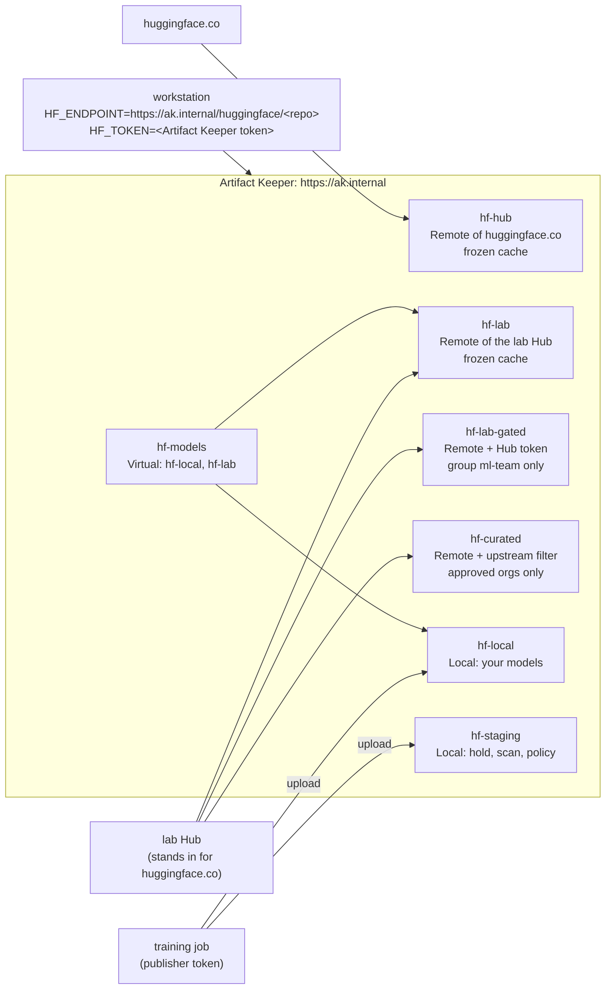

---
tags:
  - preview
  - Hugging Face
  - AI models
  - Python
  - PyPI
  - OCI
  - air-gap
  - scanning
  - quarantine
  - access control
  - TLS
description: >-
  A private Hugging Face model hub on Artifact Keeper: proxy huggingface.co, hold the Hub token
  for gated models, admit only approved model sources, host your own models, hold and scan new
  files, then freeze the cache and serve every model from a network with no route out.
---

# A private Hugging Face model hub

--8<-- "includes/preview-hf.md"

!!! warning "An example, not a complete defense"
    This walkthrough shows one way to run a private Hugging Face model hub on Artifact Keeper.
    The configuration is an example, built and tested in a lab. It does not cover every edge
    case or attack, and it is not a hardened production setup. In particular, Artifact Keeper
    decides which model files a workstation can download and keeps a copy of them; it does
    **not** inspect model files: no scanner reads pickle, safetensors or GGUF, so a malicious
    checkpoint passes its scans (see [Step 6](6-scan-and-hold.md)). Some gaps we found are
    listed in [Findings](findings.md). Review and adapt it for your own environment, and use it
    alongside your other controls (safetensors-only policies, `weights_only` loading, sandboxed
    inference, egress control, monitoring), not instead of them.

Every `from_pretrained("org/name")` downloads code-adjacent files from huggingface.co: weights,
tokenizers, configuration, sometimes pickles. `huggingface_hub` (the library behind `hf`,
`transformers` and `sentence-transformers`) takes its server from one variable, `HF_ENDPOINT`.
This walkthrough points that variable at Artifact Keeper's `huggingface` repository type and
builds a model hub that one organization controls:

- **A proxy of huggingface.co** that caches every file, so a second workstation's pull never
  leaves the building, and clients authenticate with Artifact Keeper tokens.
- **Gated models** through a Remote that holds the organization's Hub token, readable by one
  group only. A developer's token is never sent to the Hub.
- **Approved sources only**: an upstream filter that fetches from approved organizations and
  nothing else, not `evil-org/backdoor` and not the lookalike `sentence-transformer/...`.
- **Your own models**, published file by file and downloaded with the same libraries.
- **Hold and scan**: new files are held until a scan clears them or a reviewer releases them,
  and a scan policy refuses anything unscanned.
- **Freeze and go offline**: the cache is made authoritative, the models a site needs are
  seeded, and a workstation on a network with no route out loads them.

Everything runs in containers on one host. A small lab Hub (`lab-hub/server.py`, Python
standard library) stands in for huggingface.co, so every gate but the real-Hub ones runs
without internet access; the real-Hub checks use `sentence-transformers/all-MiniLM-L6-v2`
(about 90 MB) and report `BLOCKED(network)` when huggingface.co is out of reach. The code is in
[`private-model-hub/`](https://github.com/artifact-keeper/walkthroughs/tree/main/private-model-hub),
and `make all` followed by `make gates` reproduces the whole thing from an empty registry. No
Hugging Face account is needed.

## Who this is for

Platform, ML and security teams whose people already run `from_pretrained` on laptops, CI
runners and inference hosts. The questions are the ones you ask of packages, plus a few that
are new: which models may be downloaded at all? Who holds the Hub token for gated models, and
who can use it? Can a model be published internally with the same tooling? What is checked
before a new checkpoint is used? Can the site keep working when it is cut off from the
internet? The requirements below come from those questions.

## What you will be able to show

| | Requirement | Where |
|---|---|---|
| R1 | One private model hub over TLS with a bare hostname; reading needs an Artifact Keeper token; a Hugging Face token is refused | [Step 1](1-stand-up-the-registry.md), [Step 2](2-proxy-the-hub.md) |
| R2 | `hf`, `huggingface_hub`, `transformers` and `sentence-transformers` work unchanged with `HF_ENDPOINT`; a second pull comes from the cache | [Step 2](2-proxy-the-hub.md) |
| R3 | Gated models through a Hub token only the registry holds, for one group only; client tokens never reach the Hub | [Step 3](3-gated-and-private-models.md) |
| R4 | Only approved organizations are ever fetched; lookalikes and everything else are refused before the Hub is contacted | [Step 4](4-approve-model-sources.md) |
| R5 | Internal models are published and consumed with the same libraries; only a write token publishes | [Step 5](5-host-your-own-models.md) |
| R6 | New files are held until scanned or reviewed; unscanned files are refused; a reviewer can hold, release and reject | [Step 6](6-scan-and-hold.md) |
| R7 | With no route out, a workstation gets every seeded model from the registry; unseeded ones are not served | [Step 7](7-freeze-and-go-offline.md) |
| R8 | Every refusal is checked by a gate | [Step 8](8-prove-it-fails-safely.md) |

## The shape of it



## Before you start

- A Linux host with rootless podman 5.x and `podman compose`, curl, jq, openssl, python3 and
  GNU make. No sudo is needed anywhere.
- The backend image built from artifact-keeper#5300 (see the
  [code README](https://github.com/artifact-keeper/walkthroughs/tree/main/private-model-hub#images)),
  until it is merged; with `:dev`, everything but the hosted `snapshot_download` check runs.
- About 6 GB of free RAM for the registry stack and 15 GB of disk for images, the workstation
  image (CPU torch is most of it) and the cache.
- Internet access: container images from docker.io, ghcr.io and mcr.microsoft.com, Python
  packages from pypi.org and download.pytorch.org (pulled through the registry), and
  huggingface.co for the real-Hub checks.
- Loopback port `127.0.0.1:30449` free (change `HTTPS_PORT` in `registry/.env` otherwise).

!!! tip "Run it yourself"
    ```bash
    git clone https://github.com/artifact-keeper/walkthroughs
    cd walkthroughs/private-model-hub
    make all           # registry, workstation, proxy, gated, allowlist, host, hold, freeze
    make gates         # the eight gates, including every refusal
    make screens-ready # the UI address and where the admin password is
    ```

## Steps

1. [Stand up the registry](1-stand-up-the-registry.md): TLS, a bare hostname, the lab Hub, the Hub Remotes, users and tokens, and a workstation image built through the registry.
2. [Proxy the Hub](2-proxy-the-hub.md): `HF_ENDPOINT`, `hf download`, `snapshot_download`, `encode`, and the cache.
3. [Gated and private models](3-gated-and-private-models.md): a Remote that holds the Hub token, for one group.
4. [Approve model sources](4-approve-model-sources.md): an upstream filter for both Hub path shapes.
5. [Host your own models](5-host-your-own-models.md): publish file by file, use with the same libraries, a Virtual.
6. [Scan and hold](6-scan-and-hold.md): the upload hold, scan on upload, `block_unscanned`, release and reject.
7. [Freeze and go offline](7-freeze-and-go-offline.md): an authoritative cache, seeding, and a workstation with no route out.
8. [Prove it fails safely](8-prove-it-fails-safely.md): the eight gates.

Then [Results](results.md) and [Next steps](next-steps.md). The [lab notes](findings.md) are the
record every page is written from, including the Artifact Keeper bugs and doc gaps we hit. The
[original plan](plan.md) is kept as written, with what the build changed.
