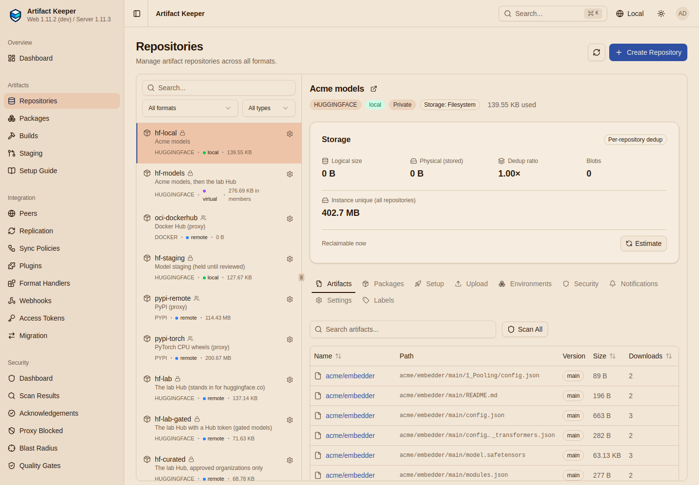
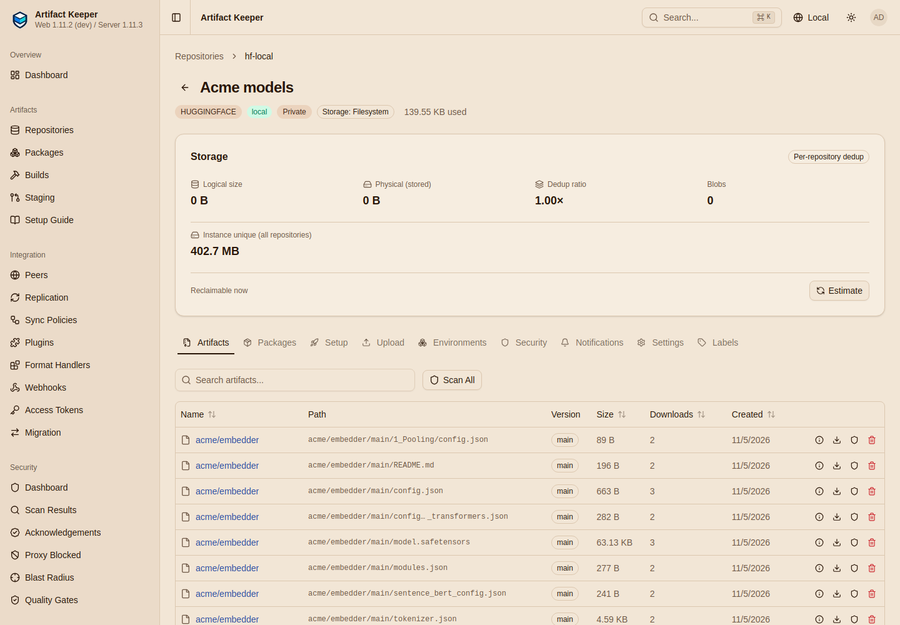
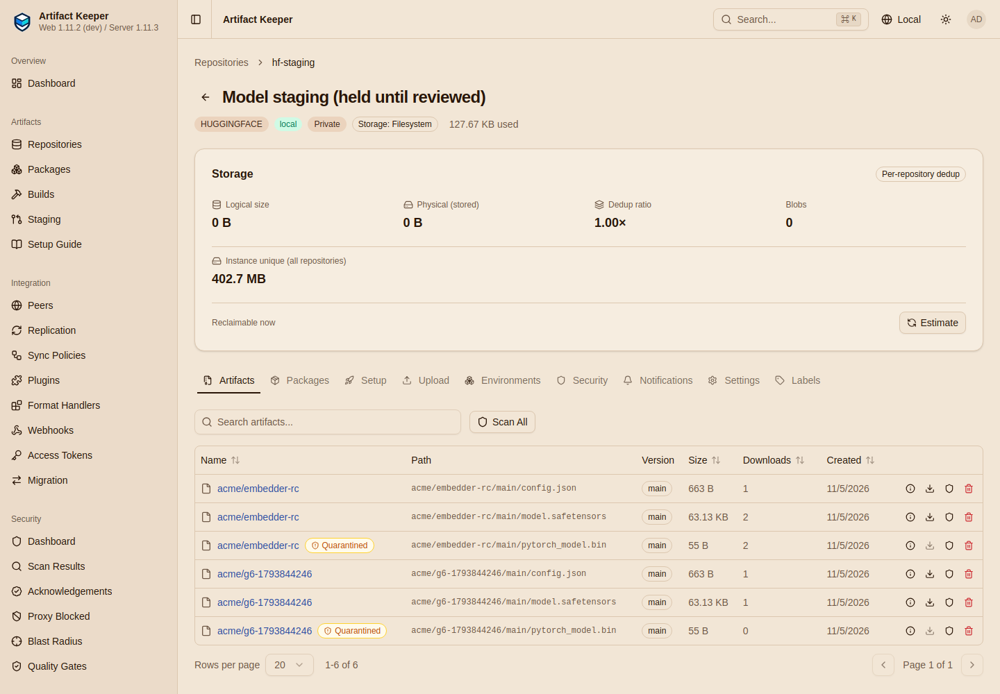
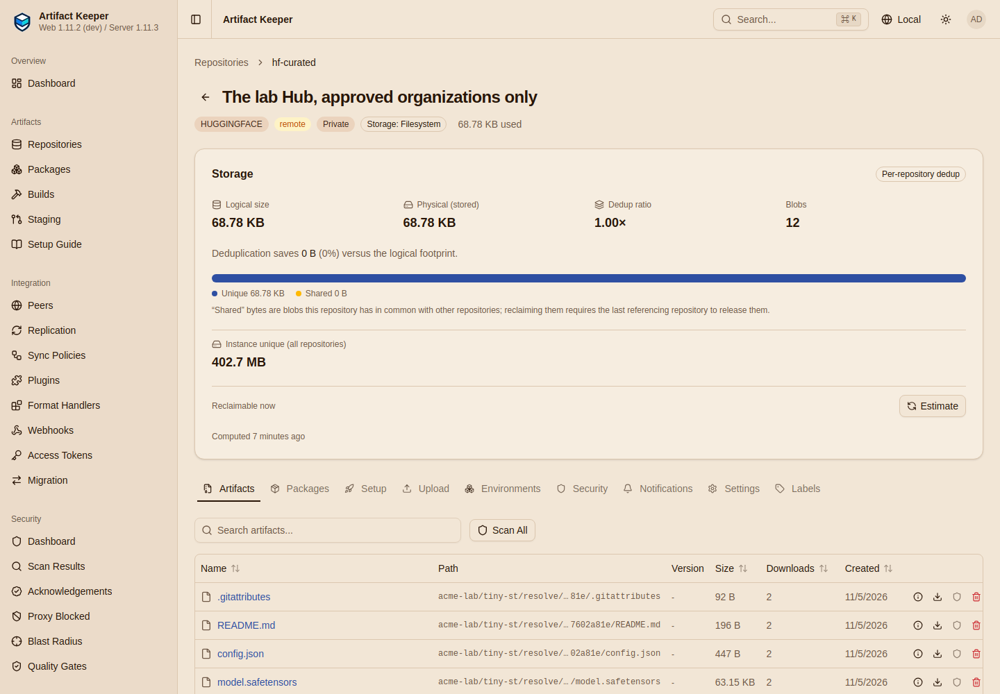
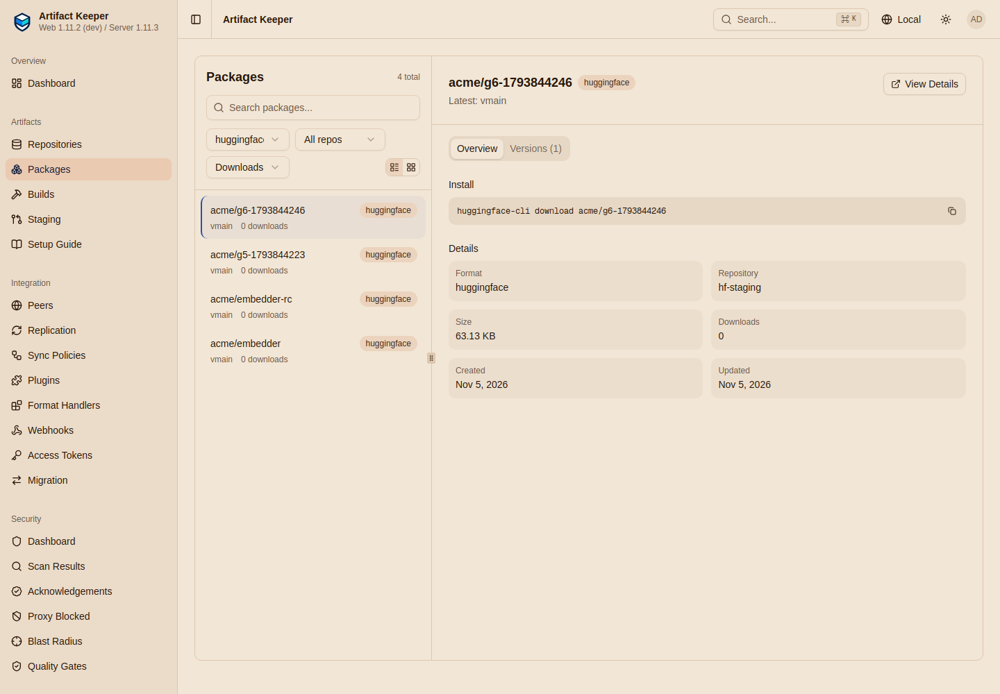

# Results

--8<-- "includes/preview-hf.md"

The reference run was on `grace` (Ubuntu 26.04, 40 cores, rootless podman 5.7) on 2026-11-05
(UTC), from an empty registry: `make clean`, `make all` (9 min 10 s, of which the workstation
image is about 4 min: CPU torch and the Hugging Face stack through the registry), `make gates`
twice (4 min each; the second after a fix to how G5 compares file lists), `make screens`.
Backend `localhost/ak-backend:hf-709e3f15`, built from artifact-keeper#5300 (`main` at
`46070a04` plus the hosted snapshot fix), web `:dev`, `huggingface_hub` 2.4.0, `transformers` 5.22.1,
`sentence-transformers` 6.2.0, torch 2.15.0+cpu. The stack images were already in the image
store. Three earlier full runs on 2026-11-04 with the `:dev` backend (`main` at `46070a04`)
found the problems recorded in the [lab notes](findings.md); the last of them ended at 75 PASS,
0 FAIL, 7 BLOCKED, the extra `BLOCKED` being G5's hosted `snapshot_download`.

## The gates

**76 PASS, 0 FAIL, 6 BLOCKED** of 82 checks.

| Gate | Result | Time |
|---|---|---|
| G1 Access | 7 PASS | 2 s |
| G2 Proxy | 9 PASS, 2 BLOCKED(ak-fix) | 26 s |
| G3 Gated | 8 PASS | 12 s |
| G4 Allowlist | 8 PASS | 1 s |
| G5 Hosted | 11 PASS | 23 s |
| G6 Hold | 8 PASS, 1 BLOCKED(ak-gap) | 2 s |
| G7 Offline | 10 PASS, 3 BLOCKED(ak-fix) | 169 s |
| G8 Fails safely | 15 PASS | 4 s |

The full list is on [Prove it fails safely](8-prove-it-fails-safely.md#the-reference-run).

## Against the requirements

| | Requirement | Result |
|---|---|---|
| R1 | One private hub over TLS; reading needs an Artifact Keeper token; a Hugging Face token is refused | Met (G1) |
| R2 | The libraries work unchanged with `HF_ENDPOINT`; a second pull comes from the cache | Met (G2), with one gap: `snapshot_download` silently leaves out files in subdirectories (F2) |
| R3 | Gated models through a Hub token only the registry holds, for one group; client tokens never reach the Hub | Met (G3) against the lab Hub; a real gated model is not machine-verified |
| R4 | Only approved organizations are fetched; lookalikes refused before the Hub is contacted | Met (G4) |
| R5 | Internal models published and consumed with the same libraries; only a write token publishes | Met (G5), with #5300 for `snapshot_download`; `upload_folder` is not supported (#5291) |
| R6 | New files held until scanned or reviewed; unscanned refused; hold, release, reject | Met (G6), but a scan does not inspect model files, so it releases a malicious pickle (F4) |
| R7 | With no route out, a workstation gets every seeded model; unseeded ones are not served | Met with `HF_HUB_OFFLINE=1` on the workstation (G7); without it, loads stall on 502 retries (F3, #5282) |
| R8 | Every refusal checked by a gate | Met |

## Artifact Keeper issues found

| | Kind | Summary |
|---|---|---|
| [F1](findings.md#f1-snapshot_download-fails-against-a-local-repository) | bug | Hosted `snapshot_download` fails: no `id` in model info, stored paths as `rfilename`, an unresolvable commit ([#5280](https://github.com/artifact-keeper/artifact-keeper/issues/5280); fixed by [#5300](https://github.com/artifact-keeper/artifact-keeper/pull/5300), verified here) |
| [F2](findings.md#f2-the-tree-listing-drops-recursivetrue-so-snapshot_download-misses-files-in-subdirectories) | bug | The tree listing drops `?recursive=true`, so `snapshot_download` misses files in subdirectories, silently |
| [F3](findings.md#f3-offline-every-uncached-path-is-a-502-after-an-upstream-attempt-and-clients-retry-it) | bug | Offline, an uncached path is a 502 after an upstream attempt; clients retry, and loads stall ([#5282](https://github.com/artifact-keeper/artifact-keeper/issues/5282)) |
| [F4](findings.md#f4-a-clean-scan-releases-a-malicious-pickle-from-the-upload-hold) | gap | No model-file scanner; a clean scan releases a malicious pickle from the upload hold ([#5285](https://github.com/artifact-keeper/artifact-keeper/issues/5285)) |
| [F5](findings.md#f5-a-cold-head-fetches-the-file-upstream-and-caches-nothing) | bug | A cold `HEAD` fetches the file upstream and caches nothing: every new file is pulled twice |
| [F6](findings.md#f6-the-cache-key-is-the-revision-as-spelled-and-every-hugging-face-path-is-mutable) | bug | Every Hugging Face path is mutable, and `main` and the commit are separate cache entries ([#5283](https://github.com/artifact-keeper/artifact-keeper/issues/5283)) |
| [D1-D7](findings.md#documentation-gaps) | docs | `siblings` claim, filter patterns, datasets, the web install hint, `quarantine_enabled` at creation, 404 for out-of-group users, freezing a warm cache |

## The web UI

Screenshots from the same stack after the run (Playwright, `make screens`). Nothing in the
walkthrough depends on the UI.

